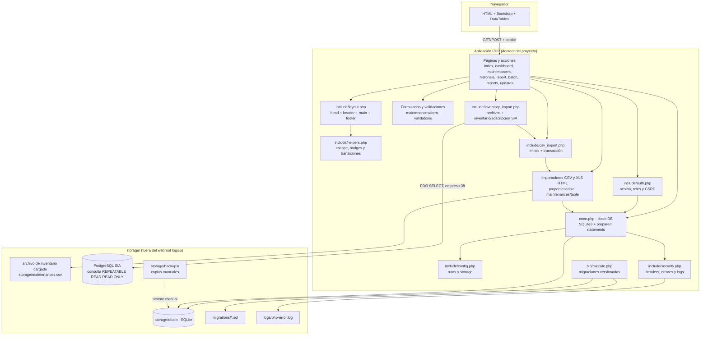
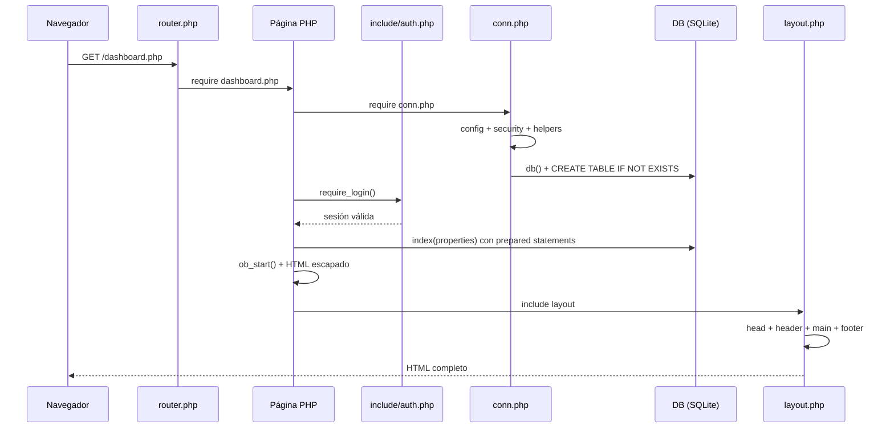
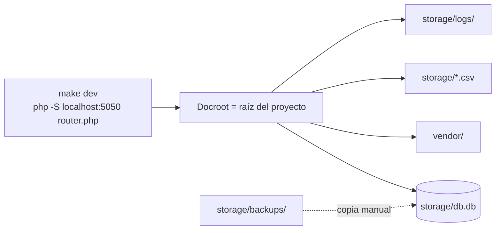

# ARCHITECTURE.md — SysTec GMB

> **Estado:** v1.2 (F2 en ejecución) · **Actualizado:** 2026-11-09.
> Describe cómo se conectan las piezas del sistema actual. El detalle de rutas y parámetros vive en `API.md`; el esquema y los datos, en `DATABASE.md`; los riesgos, en `SECURITY.md`.

## Principio rector

El sistema es un **monolito PHP renderizado en servidor** sobre un archivo SQLite. No hay capa de servicios, API ni ORM; F1 agregó autenticación, autorización, CSRF y una configuración central. Cada página es un script que:

1. Incluye `conn.php` (configuración, seguridad, helpers, clase `DB` y esquema base).
2. Exige sesión con `require_login()` o rol con `require_role()`.
3. Ejecuta consultas parametrizadas con la clase `DB`.
4. Captura HTML con `ob_start()`.
5. Incluye `include/layout.php` para envolver el contenido.

La simplicidad es deliberada: el sistema debe funcionar en un servidor PHP básico, sin dependencias externas ni base de datos servidor. El costo es acoplamiento entre presentación, acceso a datos y reglas de negocio.

## Stack tecnológico

| Capa | Tecnología | Versión / evidencia | Motivo / consecuencia |
|---|---|---|---|
| Lenguaje | PHP | 7.4.33 en el entorno analizado | Disponibilidad en hosting institucional |
| Persistencia | SQLite 3 | `storage/db.db`, extensión `sqlite3` | Cero administración; archivo único |
| Servidor | PHP built-in server + `router.php` | `make dev` → `php -S localhost:5050 router.php` | Desarrollo simple; denegaciones locales |
| Autenticación | Sesión PHP + `password_hash` | `include/auth.php`, `login.php` | Roles y CSRF sin framework |
| Configuración | Constantes + variables de entorno | `include/config.php` (`SYSTEC_STORAGE`, `SYSTEC_DB`, `SYSTEC_DEBUG`) | Rutas fuera del webroot |
| UI | Bootstrap | 5.3.2 (CSS + bundle JS) | Componentes y tema claro/oscuro |
| Tablas | DataTables + jQuery | 1.13.7 + 3.7.0 | Búsqueda, orden y paginación en cliente |
| Iconos | Bootstrap Icons | Incluido en `vendor/bootstrap/5.3.2/icon/` | Badges y acciones |
| Plantillas | PHP + output buffering | `include/layout.php` | Layout reutilizable sin motor de plantillas |
| Dependencias | Vendorizadas | `vendor/` (17 MB) | Sin Composer ni red en ejecución |
| Pruebas | Sin suite persistente | Verificaciones aisladas de F2 | Verificación manual; regresión automatizada pendiente |
| Migraciones | Runner CLI + SQL versionado | `bin/migrate.php`, `migrations/`, `schema_migrations` | Cada migración requiere backup verificado y usa transacción |

## Diagrama de componentes



## Estructura de carpetas y responsabilidades

```
systec/
├── index.php                     # Portada institucional (auth)
├── login.php / logout.php        # Autenticación
├── dashboard.php                 # Listado de bienes + búsqueda
├── maintenances.php              # Listado, alta y edición de mantenimientos
├── historials.php                # Historial imprimible por bien
├── report.php                    # Reporte de bienes dañados
├── batch.php                     # Lote de dos historiales
├── imports.php                   # Importación de maintenances.csv (GET muestra / POST importa)
├── updates.php                   # Importación desde archivo o PostgreSQL legacy
├── conn.php                      # Clase DB + conexión + catálogos + esquema
├── router.php                    # Router y denegaciones del servidor embebido
├── .htaccess                     # Denegaciones para Apache
├── Makefile                      # make dev
├── bin/
│   ├── create-user.php           # Alta/actualización de usuarios por CLI
│   └── migrate.php               # Aplicación de migraciones con backup requerido
├── migrations/                   # SQL versionado, transaccional
├── include/
│   ├── config.php                # Rutas, storage y url()
│   ├── security.php              # Headers, errores y logs
│   ├── auth.php                  # Sesión, login, roles y CSRF
│   ├── layout.php                # Layout base con output buffering
│   ├── head.php                  # Meta, CSS, JS, DataTables
│   ├── header.php                # Navegación + usuario + logout
│   ├── footer.php                # Pie institucional
│   ├── script.php                # Bootstrap bundle
│   ├── helpers.php               # Escape, badges y transiciones
│   ├── inventory_import.php      # CSV, XLS HTML, snapshot PostgreSQL y adscripción SIA
│   └── csv_import.php            # Límites y transacción de importaciones CSV
├── dashboard/
│   ├── table/index.php           # Tabla de bienes y acciones
│   └── actions/status.php        # POST cambio de estado del bien
├── maintenances/
│   ├── form/fields.php           # Campos compartidos alta/edición
│   ├── form/edit.php             # Campo estado + id oculto
│   ├── register.php              # POST alta
│   ├── update.php                # POST edición
│   ├── actions/status.php        # POST transición de estado
│   ├── table/crud.php            # Tabla + filtros + modal detalle
│   ├── table/import.php          # Importador de maintenances.csv
│   └── validations/              # Reglas de alta y edición
├── properties/
│   └── table/
│       └── propertiesCsv.php     # Procesa filas normalizadas de inventario
├── historials/
│   ├── main.php                  # Historial + observaciones
│   ├── report.php                # Variante para reporte masivo
│   ├── membrete.php              # Encabezado institucional
│   └── footer.php                # Pie de historial
├── storage/                      # db.db, backups, CSV y logs (denegado)
├── vendor/                       # Bootstrap, DataTables, jQuery
├── docs/                         # Esta documentación (denegada)
└── grafo/                        # Grafo de lógica de negocio (denegado)
```

## Ciclo de request



**Consecuencias:**

- `router.php` centraliza las denegaciones del servidor embebido; en Apache se usa `.htaccess`.
- La conexión se comparte por request con `db()` y no se cierra dentro de los métodos (H-11 resuelto).
- Los errores internos se registran en `storage/logs/php-error.log` y se responde con mensajes genéricos.
- No hay separación estricta MVC: la lógica de negocio vive mezclada en páginas, `conn.php` y validaciones.

## Módulos funcionales

| Módulo | Responsabilidad | Archivos | Frontera |
|---|---|---|---|
| Inventario | Listar, buscar y cambiar estado de bienes | `dashboard.php`, `dashboard/*` | Lee `properties`, escribe `status` |
| Mantenimientos | Alta, edición, transición y filtros | `maintenances.php`, `maintenances/*` | Lee/escribe `maintenances` |
| Historial | Historial cronológico por bien | `historials.php`, `historials/*` | Solo lectura |
| Reportes | Reporte de dañados y lote imprimible | `report.php`, `batch.php` | Solo lectura |
| Importación | Carga de CSV legacy | `updates.php`, `imports.php`, `*/table/*Csv.php`, `*/table/import.php` | Escritura masiva |
| Presentación | Layout, badges, navegación | `include/*` | Transversal |
| Persistencia | Conexión, SQL, catálogos | `conn.php` | Transversal |

## Acceso a datos

`conn.php` define `class DB extends SQLite3` con:

- `create($table, $data)`: INSERT con placeholders y lista blanca de columnas.
- `update($table, $id, $data)`: UPDATE parametrizado con `id` entero.
- `index($table, $conditions, $fields, $sort, $limit)`: SELECT parametrizado; tabla/columnas/orden validados.
- `getFirstForId`, `getFirstForConditions`: SELECT parametrizado por id/condición.
- `getCodeId($id)`: compone el código del bien.
- `getListProperties`, `getList*`: catálogos y listas para selects.
- `indexWithMaintenances`: consulta del reporte de dañados.
- `restarFechasEnHoras`: diferencia total en horas.
- `db()`: conexión compartida por request.

**Estado:** los valores nunca se concatenan; solo nombres de tabla/columna desde `$schema` y dirección de orden validada. Ver `SECURITY.md` (H-02 resuelto).
El esquema base se crea desde `conn.php`; los cambios versionados se aplican explícitamente con `php bin/migrate.php --backup=RUTA`. Las migraciones F2 normalizan datos, validan catálogos y transiciones con triggers, y agregan índices.

## Presentación

- `include/layout.php` espera `$title`, `$main`, opcionales `$no_footer`, `$header_file`, `$main_class`.
- `include/head.php` carga CSS/JS con rutas relativas (`./vendor/...`), lo que exige que la app se sirva desde la raíz del docroot.
- `include/header.php` muestra navegación (Inicio, Dashboard, Mantenimientos, Dañados), usuario/rol y logout por POST.
- `include/helpers.php` centraliza escape (`e()`, `js()`), badges, etiquetas y transiciones; es la capa de presentación pura.
- `include/security.php` aplica cabeceras y logging; `include/config.php` resuelve rutas y `url()`.
- Las vistas escapan todos los datos de usuario; los formularios incluyen `csrf_field()`.

## Despliegue y operación



- **Desarrollo:** `make dev` en la raíz; `router.php` deniega rutas sensibles.
- **Producción:** Apache/PHP con el proyecto como docroot y `.htaccess`, o Nginx con reglas equivalentes. Lo ideal es mover `storage/` fuera del `DocumentRoot` real.
- **Variables de entorno:** `SYSTEC_STORAGE`, `SYSTEC_DB`, `SYSTEC_DEBUG` (opcionales). La zona horaria se fija en código (`America/Caracas`).
- **Backups:** hay un backup F2 restaurado en pruebas. La propuesta registrada pide diario a las 02:00, retención 30/12/12 y restore trimestral; falta aprobación TI, destino separado, cifrado y cron. Ver `BACKUP.md`.
- **Observabilidad:** log de PHP en `storage/logs/php-error.log`; sin métricas ni healthcheck.

## Calidad y pruebas

| Garantía | Estado | Mecanismo |
|---|---|---|
| Sintaxis PHP | Manual | `php -l` limpio; no automatizado |
| Reglas de negocio | Manual | Sin tests automatizados |
| Importación CSV | Verificación aislada F2 | Límites y rollback/commit verificados; sin suite persistente |
| Regresión visual | Manual | Navegación e impresión |
| Seguridad | Parcial | Controles F1 + pruebas manuales; ver `SECURITY.md` |

## Deudas arquitectónicas principales

1. **Seguridad de despliegue pendiente:** HTTPS/HSTS, rate limiting y auditoría (F1 dejó auth, CSRF, escape y SQL parametrizado).
2. **Persistencia parcial:** hay migraciones, triggers e índices; aún no hay FK ni suite automatizada (H-13).
3. **Lógica duplicada:** cálculo de vencimiento en vista, cálculo de código en `conn.php`, validaciones parciales.
4. **Catálogo de técnicos libre:** valores conocidos se normalizaron, pero no existe catálogo relacional.
5. **Reportes con supuestos:** reporte deduplicado; el criterio textual de desincorporación sigue siendo literal.
6. **Operación de importaciones:** transaccional y limitada; faltan pruebas persistentes y una estrategia operativa de backup.

## Decisiones pendientes que afectan la arquitectura

| Tema | Bloquea | Documento |
|---|---|---|
| HTTPS/HSTS y rate limiting | Exponer el sistema fuera de la red local | `SECURITY.md`, `TODO.md` |
| Escala de estados del bien | Reglas de reporte y UI | `DOMAIN.md`, `DECISIONS.md` |
| Significado de `time_taken` | Reportes de esfuerzo | `DOMAIN.md`, `DECISIONS.md` |
| Calendario, retención y cifrado de backups | Recuperación operativa | `DATABASE.md`, `SECURITY.md`, `TODO.md` |
| Framework o reescritura | Costo/beneficio de modernizar | `DECISIONS.md` (ADR-013 propuesto) |

---

Ver también: `README.md`, `PROJECT.md`, `DOMAIN.md`, `DATABASE.md`, `BACKUP.md`, `API.md`, `SECURITY.md`, `DECISIONS.md`, `TODO.md`, `grafo/logica-negocio.md`.
