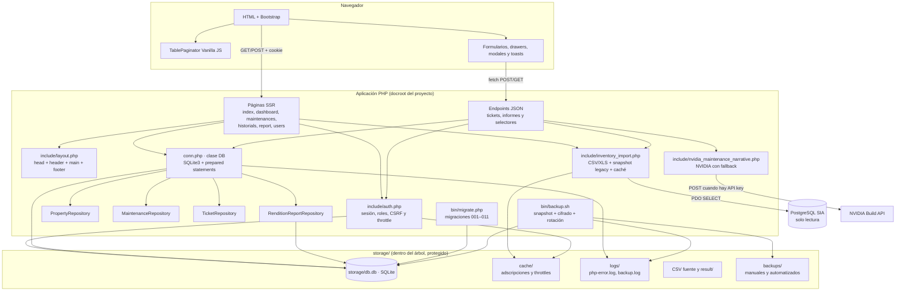
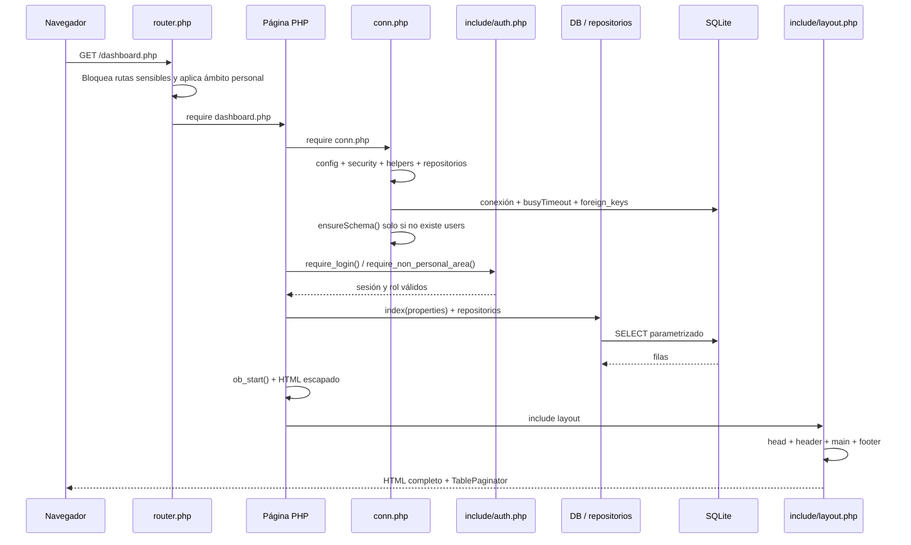
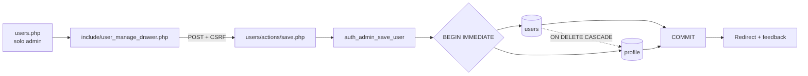
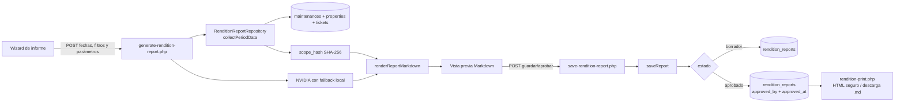
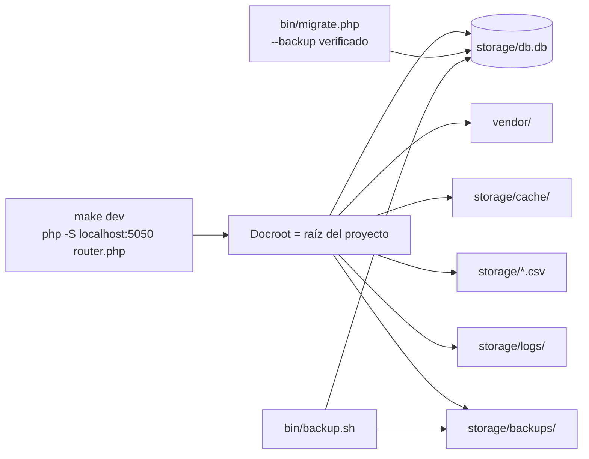

# ARCHITECTURE.md — SysTec GMB

> **Estado:** v2.0 (repositorios especializados, informes de rendición, usuarios/perfiles y CI) · **Actualizado:** 2026-11-26.
> **Snapshot de referencia:** base SQLite con migraciones 001–011 aplicadas; detalles y conteos en `DATABASE.md`.
> Describe cómo se conectan las piezas actuales. Las rutas y parámetros viven en `API.md`; el esquema, en `DATABASE.md`; los riesgos, en `SECURITY.md`.

## Principio rector

El sistema es un **monolito PHP renderizado en servidor** sobre SQLite. No hay ORM ni una capa de servicios; sí hay repositorios especializados para inventario, mantenimientos, tickets e informes de rendición. La autenticación, autorización, CSRF, escape, logging y throttling son transversales.

Una página HTML sigue este patrón:

1. Incluye `conn.php` (configuración, seguridad, helpers, clase `DB` y repositorios).
2. Incluye `include/auth.php` y exige sesión/rol con `require_login()`, `require_role()` o un guard específico.
3. Lee datos mediante `DB` o sus repositorios.
4. Captura HTML con `ob_start()`.
5. Incluye `include/layout.php` para envolver el contenido.

Los endpoints JSON siguen el mismo modelo, pero responden con `json_encode` en lugar de layout. La simplicidad es deliberada: la aplicación debe funcionar en un servidor PHP básico, sin build frontend ni base de datos servidor para la persistencia principal. El costo es acoplamiento entre páginas, validación, SQL y reglas de negocio.

## Stack tecnológico

| Capa | Tecnología | Versión / evidencia | Motivo / consecuencia |
|---|---|---|---|
| Lenguaje | PHP | **8.2.0 mínimo**: `composer.json` fija `config.platform.php` en `8.2.0` | Línea base de Composer y de CI |
| Persistencia principal | SQLite 3 | `storage/db.db`, extensión `sqlite3` | Archivo único, sin administración de servidor |
| Persistencia auxiliar | PDO PostgreSQL | Solo consulta legacy de inventario, `REPEATABLE READ READ ONLY` | Adscripciones/asignaciones; no es la base de SysTec |
| Servidor | PHP built-in server + `router.php` | `make dev` → `php -S localhost:5050 router.php` | Desarrollo simple y denegaciones locales |
| Autenticación | Sesión PHP + `password_hash` | `include/auth.php`, `login.php` | Roles, CSRF y throttle sin framework |
| Configuración | Constantes + entorno + `.env` | `include/config.php` | `SYSTEC_STORAGE`, `SYSTEC_DB`, `SYSTEC_DEBUG`, credenciales legacy y API narrativa |
| UI | Bootstrap | 5.3.2 vendorizado | Componentes y tema claro/oscuro |
| Tablas y paginación | **Vanilla JS (`TablePaginator`)** | `assets/js/table-paginator.js` | Búsqueda, ordenamiento y paginación numérica con ventana deslizante; **sin jQuery/DataTables** |
| Iconos | Bootstrap Icons | `vendor/bootstrap/5.3.2/icon/` | Badges y acciones |
| Plantillas | PHP + output buffering | `include/layout.php` | Sin motor de plantillas |
| Dependencias PHP | Composer | `jbzoo/mermaid-php ^7.2.6`; PHPUnit `^9.6` en desarrollo | Dependencias bloqueadas en `composer.lock`; UI vendorizada |
| Pruebas y CI | PHPUnit 9.6 + GitHub Actions | `make ci`, `composer ci`, `.github/workflows/ci.yml` | PHP 8.2; **115 pruebas / 1095 aserciones** verificadas en la sesión 2026-11-26 |
| Migraciones | Runner CLI | `bin/migrate.php`, `migrations/001…011` | Transaccionales y registradas en `schema_migrations` |
| Backups | CLI Bash + PHP SQLite | `bin/backup.sh` | Snapshot consistente, verificación, cifrado opcional y rotación 30/12/12 |
| Narrativa asistida | NVIDIA Build API con fallback | `include/nvidia_maintenance_narrative.php` | Mejora textos e informes; no es obligatoria para guardar |

Aunque el árbol `vendor/` conserva una carpeta `datatables`, el frontend actual no carga jQuery ni DataTables. Las tablas del cliente usan `window.Systec.TablePaginator`.

## Diagrama de componentes



## Estructura de carpetas y responsabilidades

```text
systec/
├── index.php / dashboard.php        # Portada y resumen de inventario
├── maintenances.php                 # Listado, filtros, alta/edición e informes
├── historials.php / report.php      # Historial por bien y bienes dañados
├── batch.php                        # Lote imprimible de historiales
├── imports.php / updates.php        # Importación de mantenimientos e inventario
├── sync-assignments.php             # Sincronización manual de asignaciones legacy
├── tickets.php                      # Bandeja de soporte
├── personal/                        # Área de tickets propios del rol personal
├── tickets/                         # Acciones y detalle de tickets de soporte
├── users.php                        # Administración de cuentas y perfiles (admin)
├── users/actions/save.php           # POST transaccional de usuarios/perfiles
├── login.php / logout.php           # Autenticación
├── documentation.php                # Documentación renderizada
├── conn.php                         # DB, lista blanca SQL, bootstrap y repositorios
├── router.php / .htaccess           # Router y denegaciones HTTP
├── Makefile / composer.json         # Desarrollo, lint, pruebas e CI
├── bin/
│   ├── create-user.php              # Alta/actualización de usuarios por CLI
│   ├── migrate.php                  # Migraciones con backup verificado obligatorio
│   ├── seed-profiles.php            # Upsert idempotente de perfiles canónicos
│   ├── backup.sh                    # Backup consistente, cifrado y rotación
│   ├── deduplicate-maintenances.php # Duplicados del reporte de mantenimientos
│   └── improve-maintenance-narrative.php
├── migrations/                      # SQL versionado 001–011
├── include/
│   ├── config.php                   # Rutas, storage, entorno y url()
│   ├── security.php                 # CSP, headers, errores y rotación de logs
│   ├── auth.php                     # Sesión, roles, CSRF, throttle y usuarios/perfiles
│   ├── layout.php / head.php        # Layout, CSS/JS y CSP nonce
│   ├── header.php / footer.php      # Navegación y pie
│   ├── script.php                   # Bootstrap bundle + toasts
│   ├── helpers.php                  # Escape, badges, categorías y adscripciones
│   ├── user_manage_drawer.php       # Drawer de alta/edición de usuario y perfil
│   ├── user_delete_modal.php        # Confirmación de borrado permanente
│   ├── password_change_modal.php    # Cambio de propia contraseña
│   ├── inventory_import.php         # CSV/XLS, PostgreSQL y caché local
│   ├── csv_import.php               # Límites y transacción de importación
│   ├── nvidia_maintenance_narrative.php
│   ├── property_picker_api.php      # Selector de bienes por ámbito
│   ├── repositories/
│   │   ├── PropertyRepository.php
│   │   ├── MaintenanceRepository.php
│   │   ├── TicketRepository.php
│   │   └── RenditionReportRepository.php
│   └── *_modal.php / *_drawer.php   # Componentes compartidos de tickets y mantenimientos
├── assets/js/                       # TablePaginator, toasts, selectores y módulos UI
├── dashboard/                       # Tabla, filtros y cambio de estado del bien
├── maintenances/                    # Formularios, acciones, impresión e informes
├── historials/                      # Encabezado, historial y variante de lote
├── properties/table/                # Procesamiento de filas de inventario
├── template/informe_rendicion.md    # Plantilla Markdown del informe
├── tests/Unit/                      # Suite PHPUnit
├── storage/                         # DB, caché, logs, CSV, backups y resultados
├── vendor/                          # Bootstrap y dependencias Composer
├── docs/ / grafo/ / spec/           # Documentación interna denegada por HTTP
└── .github/workflows/ci.yml         # CI en PHP 8.2
```

## Ciclo de request



**Consecuencias:**

- `router.php` centraliza las denegaciones del servidor embebido; Apache usa `.htaccess`. La protección de `storage/` es indispensable porque el directorio está dentro del proyecto.
- `db()` mantiene una conexión compartida por request; los métodos no la cierran.
- `ensureSchema()` no es un runner: si detecta `users`, no migra columnas ni tablas. Ver `DATABASE.md`.
- Los errores se registran en `storage/logs/php-error.log`; en producción se responde con mensajes genéricos.
- No hay separación estricta MVC: las páginas aún componen validaciones, consultas y presentación.

## Módulos funcionales

| Módulo | Responsabilidad | Archivos principales | Frontera |
|---|---|---|---|
| Inventario | Listar, buscar, filtrar y cambiar estado de bienes | `dashboard.php`, `dashboard/*`, `PropertyRepository` | Lee `properties`; adscripciones desde caché institucional con respaldo local |
| Mantenimientos | Alta, edición, transición, filtros, impresión e importación | `maintenances.php`, `maintenances/*`, `MaintenanceRepository` | Escribe `maintenances`; enlaza ticket opcional del mismo bien |
| Dañados e historial | Consulta e impresión por bien o lote | `report.php`, `historials.php`, `historials/*`, `batch.php` | Principalmente lectura; criterio textual de desincorporación |
| Informes de rendición | Alcance/período, Markdown, borrador, aprobación e impresión | `maintenances/form/rendition_wizard_modal.php`, `maintenances/actions/*rendition*`, `RenditionReportRepository` | Persiste snapshot JSON + Markdown; aprobación inmutable en aplicación |
| Tickets de soporte | Registro, bandeja, estados, comentarios y baja lógica | `tickets.php`, `tickets/*`, `TicketRepository` | Roles admin/operador/técnico/consulta; gestión limitada por rol |
| Tickets personales | Registro y seguimiento de tickets propios | `personal/*`, `TicketRepository` | Aislamiento por `created_by`; paginación en servidor |
| Usuarios y perfiles | Cuentas, roles, técnicos, credenciales y perfiles | `users.php`, `users/actions/save.php`, `include/user_manage_drawer.php`, `include/auth.php` | Solo admin; usuario+perfil en una transacción |
| Importación y sincronización | CSV/XLS, inventario legacy y asignaciones | `imports.php`, `updates.php`, `sync-assignments.php`, `include/inventory_import.php` | Escritura masiva transaccional; PostgreSQL solo lectura |
| Presentación | Layout, badges, navegación, toasts y componentes | `include/*`, `assets/js/*` | Transversal; TablaPaginator en cliente |
| Persistencia | Conexión, SQL, catálogos y repositorios | `conn.php`, `include/repositories/*` | Transversal; lista blanca de tablas/columnas |

## Acceso a datos

### Clase `DB`

`conn.php` define `class DB extends SQLite3` con:

- `create($table, $data)`: INSERT parametrizado con lista blanca de columnas.
- `update($table, $id, $data)`: UPDATE parametrizado por ID entero.
- `index($table, $conditions, $fields, $sort, $limit)`: SELECT parametrizado; tabla, columnas, operadores y orden validados.
- `countRows`, `getFirstForId`, `getFirstForConditions`: consultas parametrizadas.
- `fetchAllQuery($query, $params)`: SQL interno parametrizado.
- `select($query)`: reservado para SQL estático interno; nunca debe recibir entrada de usuario.
- `getListRoles()`: catálogo de roles.
- `db()`: conexión compartida por request.
- `properties()`, `maintenances()`, `tickets()`, `renditionReports()`: repositorios lazy.

`DB::$schema` actúa como lista blanca e incluye todas las columnas actuales, incluso las agregadas por migraciones. Eso no significa que `ensureSchema()` las cree en una base antigua.

### Repositorios especializados

| Repositorio | Responsabilidad | Ejemplos |
|---|---|---|
| `PropertyRepository` | Importación/upsert por `ident`, sincronización de adscripciones/asignaciones, códigos, resúmenes y metadatos de filtros | `createOrUpdate()`, `syncPropertyAssignments()`, `buildFilterMetadata()` |
| `MaintenanceRepository` | Consultas agregadas, reporte de dañados, grupos por bien, catálogos, vencimientos y duración | `maintenanceCountsByProperty()`, `dashboardSummaryCounts()`, `urgentMaintenances()` |
| `TicketRepository` | Bandejas, filtros personales, JOIN sin N+1, historial con actores y baja lógica transaccional | `supportTickets()`, `personalTickets()`, `softDeleteTicket()` |
| `RenditionReportRepository` | Normalización de alcance, SHA-256, recolección de datos, Markdown, códigos correlativos y ciclo de vida | `computeScopeHash()`, `collectPeriodData()`, `renderReportMarkdown()`, `saveReport()` |

`DB` conserva métodos delegados hacia estos repositorios para compatibilidad con páginas y pruebas existentes. La ruta preferida para lógica nueva es el repositorio correspondiente.

### Integridad y transacciones

- Los valores se vinculan con placeholders. Los nombres de tabla/columna/orden provienen de listas blancas o mapas internos.
- `profile` es la única FK física y usa cascada. Las relaciones de tickets, mantenimientos e informes se validan en aplicación.
- El cambio de estado de ticket y su evento se hacen en una transacción; la baja lógica también.
- El alta/edición de usuario y perfil se hace en una transacción.
- Las importaciones CSV/XLS se ejecutan en transacción con límites y rollback.
- El alta de ticket y algunas escrituras simples no envuelven todas sus operaciones en una transacción explícita; es una deuda de consistencia.

## Usuarios, perfiles y sesión



- `users.php` lista cuentas con `LEFT JOIN profile`, indicadores por rol/estado y bloqueos de throttle. Usa `TablePaginator` en cliente y permite exportar el resultado filtrado a CSV.
- El drawer gestiona username, rol, estado, contraseña, nombre, apellidos y URL de avatar. En edición, username queda de solo lectura y la contraseña es opcional.
- `auth_admin_save_user()` crea/actualiza la cuenta y, si se indican ambos nombres, crea/actualiza el perfil antes del `COMMIT`.
- `auth_admin_delete_user()` exige doble confirmación, impide eliminar la cuenta en sesión y protege al último administrador activo. El `DELETE` elimina el perfil por cascada.
- El email se muestra y exporta, pero el formulario actual no permite editarlo.
- `auth_change_password()` verifica la contraseña actual y actualiza el hash del propio usuario.
- `bin/create-user.php` sigue siendo una alternativa CLI; `bin/seed-profiles.php` sincroniza perfiles canónicos y falla completo si falta un username.
- El rol `personal` tiene navegación y router restringidos a `/personal/*`, con acceso a sus propios tickets. Los roles admin/operador/técnico/consulta usan la bandeja de soporte.
- El throttle usa archivos JSON bajo `storage/cache/throttles`: 5 intentos por usuario o 15 por IP en 15 minutos.

**Inconsistencia de datos actual:** el snapshot contiene `abrizuela` con perfil y no contiene `abrizzuela`, el username canónico. El seeder de perfiles fallará hasta reconciliar esa identidad. Ver `DATABASE.md`.

## Informes de rendición



- El hash se calcula con `date_from`, `date_to`, categoría, adscripción, estado, tipo y técnico normalizados. Un mismo alcance reutiliza el informe.
- Los datos del snapshot se guardan en `stats_json`, `maintenance_ids_json` y `ticket_ids_json`; el documento se guarda en `content_markdown`.
- `rendition_reports` nació en 008. `ensureTableExists()` del repositorio puede crearla con sus índices en runtime como salvaguarda, sin registrar la migración.
- `saveReport()` actualiza un borrador existente o crea `IR-YYYY-NNNN`; al aprobar completa `approved_by` y `approved_at`.
- Un informe aprobado no se puede sobrescribir mediante `saveReport()`. El borrado físico sigue disponible para admin en un endpoint separado.
- La vista de impresión convierte un subconjunto de Markdown/HTML a HTML escapado y permite descargar el `.md` original.

## Integración con inventario legacy y caché

- `updates.php` importa CSV/XLS o consulta PostgreSQL legacy en modo de solo lectura.
- `sync-assignments.php` consulta responsable/asignado y actualiza `properties` dentro de una transacción.
- Las lecturas normales de dashboard, mantenimientos y tickets no consultan PostgreSQL en cada request: leen `storage/cache/inventory-adscriptions-*.json`.
- La caché usa hash del conjunto de identificadores, archivo `.lock`, escritura temporal y renombrado atómico. `SYSTEC_LEGACY_CACHE_TTL` controla la vigencia local (24 h por defecto).
- Si no hay caché institucional, se usa `properties.adscription`; si la caché está vencida, se muestra como tal y puede refrescarse en segundo plano con FastCGI.

## Presentación y paginación

- `include/layout.php` espera `$title`, `$main` y opcionales `$no_footer`, `$header_file`, `$main_class`.
- `include/head.php` carga Bootstrap, iconos, `responsive.css` y `assets/js/table-paginator.js` mediante `url()`, por lo que la app puede servirse desde un subdirectorio del docroot.
- `include/header.php` muestra Inicio, Dashboard, Mantenimientos, Tickets, Dañados y Usuarios según rol; admin/operador ven el menú Importar. `personal` ve únicamente Tickets personales.
- `TablePaginator` implementa búsqueda sin diacríticos, ordenación por columnas, tamaños de página, contador, estados vacíos y paginación numérica con ventana deslizante. No requiere jQuery.
- Dashboard, mantenimientos, tickets de soporte y usuarios cargan sus filas y luego filtran/paginan en cliente. La bandeja personal usa paginación SQL de 25 filas y enlaces numerados en servidor.
- `include/helpers.php` centraliza `e()`, `js()`, badges, categorías, adscripciones y toasts.
- `include/security.php` genera un nonce CSP por request, aplica headers y rota el log de PHP a 5 MiB con 5 archivos.

## Despliegue y operación



- **Desarrollo:** `make dev`; `router.php` deniega `/storage`, `/docs`, `/include`, `/migrations`, extensiones sensibles y otras rutas internas.
- **Producción Apache:** proyecto como docroot y `.htaccess` con denegaciones equivalentes. En Nginx hay que replicar las reglas; no basta con que el código use `SYSTEC_STORAGE`.
- **Ubicación de datos:** `storage/` está dentro del árbol. Puede reubicarse con `SYSTEC_STORAGE`/`SYSTEC_DB`, pero la configuración actual no garantiza que esté fuera del `DocumentRoot`.
- **Variables de entorno:** `SYSTEC_STORAGE`, `SYSTEC_DB`, `SYSTEC_DEBUG`, `SYSTEC_LEGACY_CACHE_TTL`, credenciales PostgreSQL y `API_KEY_NVIDIA_BUILD`. Zona horaria de aplicación: `America/Caracas`.
- **Migraciones:** ejecutar `php bin/migrate.php --backup=RUTA`; el backup debe superar integridad y coincidir en conteos de propiedades, mantenimientos y usuarios.
- **Backups:** el script hace snapshot con la API SQLite, verifica integridad, incluye CSV/manifest, puede cifrar y rota 30/12/12. Cron, destino separado y custodia de claves siguen pendientes; ver `BACKUP.md`.
- **Observabilidad:** log de PHP con rotación; `backup.log` cuando se ejecuta el script; sin métricas ni healthcheck.

## Calidad y pruebas

| Garantía | Estado | Mecanismo |
|---|---|---|
| Sintaxis PHP | Automatizada | `make lint` / `composer lint` y paso equivalente en CI |
| Reglas de negocio | Automatizada parcialmente | PHPUnit; suite actual de 115 pruebas y 1095 aserciones |
| CI | Activo en GitHub Actions | PHP 8.2, extensiones `sqlite3`, `pdo_sqlite`, `mbstring`, `json`; lint + PHPUnit |
| Repositorios y consultas | Cubiertos por pruebas unitarias | Bases `:memory:` y temporales; pruebas de N+1, filtros y resúmenes |
| Migraciones/perfiles/backup | Cubiertos por pruebas unitarias | Migraciones y comandos sobre bases temporales aisladas |
| Importación CSV | Pruebas de límites y rollback | `InventoryImportTest` |
| Regresión visual | Manual | Navegación responsive e impresión |
| Seguridad | Parcial | Auth, CSRF, escape, CSP y throttle automatizados/manuales; ver `SECURITY.md` |

Comandos habituales:

```bash
make dev
make lint
make test
make ci
# Equivalentes Composer: composer lint, composer test, composer ci
```

## Deudas arquitectónicas principales

1. **Bootstrap no migrante:** `ensureSchema()` no completa bases antiguas; un restore debe pasar por el runner.
2. **Integridad parcial:** solo `profile` tiene FK; el resto depende de validación y disciplina de escritura.
3. **Transacciones heterogéneas:** usuarios, cambios de estado, baja lógica e importaciones son transaccionales, pero algunas escrituras compuestas no lo son.
4. **Paginación en cliente:** las tablas grandes de dashboard/mantenimientos/tickets se cargan completas antes de filtrar; la bandeja personal ya pagina en SQL.
5. **Consistencia de cuentas:** `abrizuela`/`abrizzuela`, cuenta `personal` y emails ausentes requieren reconciliación.
6. **Inmutabilidad de informes por aplicación:** no hay trigger que impida modificar un aprobado y admin puede eliminarlo físicamente.
7. **Lógica duplicada:** persisten cálculos y validaciones en páginas, helpers y repositorios.
8. **Caché legacy:** puede estar vencida o ausente; requiere permisos y una estrategia de refresco operativa.
9. **Auditoría limitada:** hay logs puntuales, pero no una bitácora relacional consultable.
10. **Operación de backups:** script probado, pero cron, destino separado, cifrado obligatorio y monitoreo no están cerrados.

## Decisiones pendientes que afectan la arquitectura

| Tema | Bloquea | Documento |
|---|---|---|
| Reconciliación de usernames/email canónicos | Seeder y continuidad de cuentas | `DATABASE.md`, `TODO.md` |
| Estandarización de fechas y FKs adicionales | Integridad y reproducibilidad | `DATABASE.md`, `DECISIONS.md` |
| Política de borrado/retención de informes aprobados | Trazabilidad documental | `DATABASE.md`, `BACKUP.md` |
| HTTPS/HSTS y auditoría relacional | Exposición y control administrativo | `SECURITY.md`, `TODO.md` |
| Calendario, retención y cifrado de backups | Recuperación operativa | `DATABASE.md`, `SECURITY.md`, `TODO.md` |
| Paginación servidor para tablas grandes | Escala de UI y memoria | `DECISIONS.md` |
| Framework o reescritura | Costo/beneficio de modernización | `DECISIONS.md` |

---

Ver también: `README.md`, `PROJECT.md`, `DOMAIN.md`, `DATABASE.md`, `BACKUP.md`, `API.md`, `SECURITY.md`, `DECISIONS.md`, `TODO.md`, `grafo/logica-negocio.md`.
