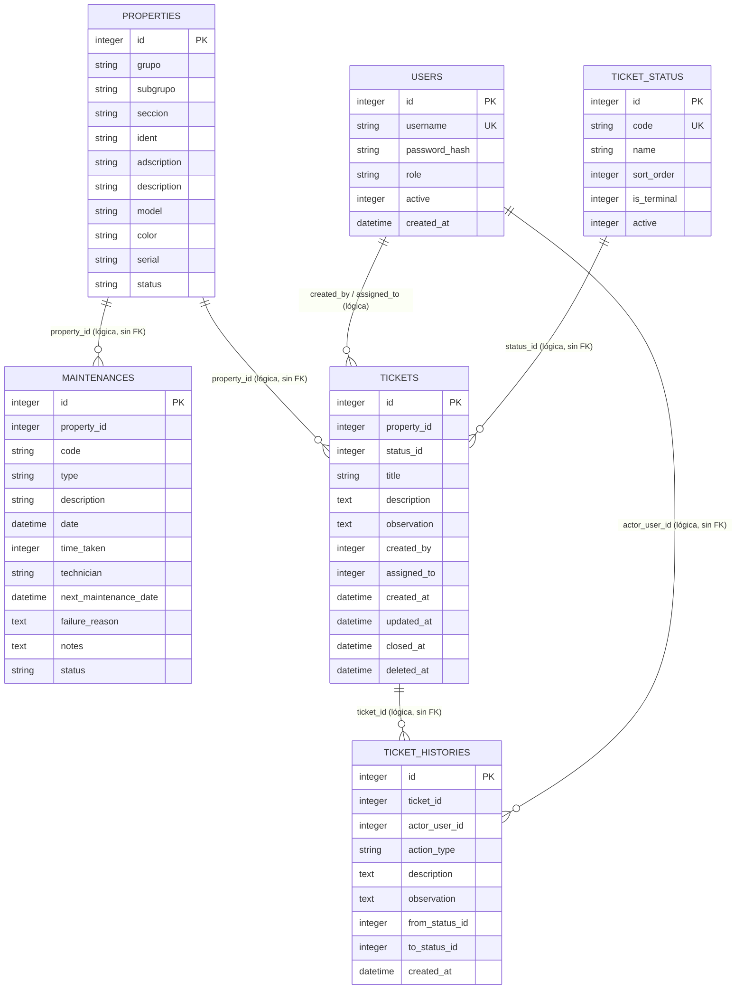
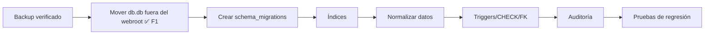

# DATABASE.md — SysTec GMB

> **Estado:** v1.4 (esquema de tickets documentado) · **Actualizado:** 2026-11-11.
> **Motor:** SQLite 3, archivo `storage/db.db`.
> **Regla de oro:** migraciones versionadas aplican normalización, triggers e índices. Aún no existe `FOREIGN KEY`; `users.username` es `UNIQUE`.

---

## 1. Motor y convenciones

| Ítem | Situación actual | Consecuencia |
|---|---|---|
| Motor | SQLite 3 | Archivo único, cero administración, sin concurrencia real |
| Archivo | `storage/db.db` (ruta configurable con `SYSTEC_DB`) | Fuera del webroot y denegado por router/htaccess |
| Creación de esquema | Tablas base en `conn.php`; evoluciones en `migrations/` | Versiones registradas en `schema_migrations` |
| Tipos | `INTEGER`, `STRING`, `DATETIME`, `VARCHAR(255)`, `TEXT` | Afinidad dinámica de SQLite; sin validación estricta |
| Fechas | Normalizadas a `YYYY-MM-DD HH:MM:SS`; ausencias como `NULL` | Formato consistente tras F2 |
| Identificadores | `INTEGER PRIMARY KEY AUTOINCREMENT` | Sin UUID ni claves naturales |
| Nombres | `snake_case`, plural (`properties`, `maintenances`, `users`, `tickets`) | Convención de facto |
| Borrado | Tickets con baja lógica; otros datos no se eliminan desde la app | El historial del ticket se conserva para trazabilidad |
| Auditoría | No existe | Sin `created_at`, `updated_at`, `created_by` en datos |
| Backups | Manuales en `storage/backups/` | Sin retención ni restore periódico probado |
| Concurrencia | SQLite con conexiones por request y `busyTimeout(5000)` | Escrituras concurrentes pueden bloquear |
| Claves foráneas | `PRAGMA foreign_keys = ON` sin FK declaradas | La relación sigue en código |
| Catálogos | Triggers para estados, transiciones y tipos | Reglas críticas también se aplican en SQLite |
| Índices | `ident`, `property_id`, `(status, next_maintenance_date)` | Agregados por migración F2 |

---

## 2. Diagrama entidad-relación



---

## 3. DDL efectivo

El esquema se crea en `conn.php` al instanciar `DB`:

```sql
CREATE TABLE IF NOT EXISTS properties (
    id          INTEGER PRIMARY KEY AUTOINCREMENT,
    grupo       STRING,
    subgrupo    STRING,
    seccion     STRING,
    ident       STRING,
    adscription STRING,
    description STRING,
    model       STRING,
    color       STRING,
    serial      STRING,
    status      STRING
);

CREATE TABLE IF NOT EXISTS maintenances (
    id                    INTEGER PRIMARY KEY AUTOINCREMENT,
    property_id           INTEGER,
    code                  STRING,
    type                  STRING,
    description           STRING,
    date                  DATETIME,
    time_taken            INTEGER,
    technician            VARCHAR(255),
    next_maintenance_date DATETIME,
    failure_reason        TEXT,
    notes                 TEXT,
    status                STRING
);

CREATE TABLE IF NOT EXISTS users (
    id            INTEGER PRIMARY KEY AUTOINCREMENT,
    username      TEXT NOT NULL UNIQUE,
    password_hash TEXT NOT NULL,
    role          TEXT NOT NULL DEFAULT 'consulta',
    active        INTEGER NOT NULL DEFAULT 1,
    created_at    DATETIME NOT NULL DEFAULT CURRENT_TIMESTAMP
);

CREATE TABLE IF NOT EXISTS ticket_status (
    id          INTEGER PRIMARY KEY AUTOINCREMENT,
    code        TEXT NOT NULL UNIQUE,
    name        TEXT NOT NULL,
    sort_order  INTEGER NOT NULL DEFAULT 0,
    is_terminal INTEGER NOT NULL DEFAULT 0,
    active      INTEGER NOT NULL DEFAULT 1
);

CREATE TABLE IF NOT EXISTS tickets (
    id          INTEGER PRIMARY KEY AUTOINCREMENT,
    property_id INTEGER NOT NULL,
    status_id   INTEGER NOT NULL,
    title       TEXT NOT NULL,
    description TEXT NOT NULL,
    observation TEXT,
    created_by  INTEGER NOT NULL,
    assigned_to INTEGER,
    created_at  DATETIME NOT NULL DEFAULT CURRENT_TIMESTAMP,
    updated_at  DATETIME NOT NULL DEFAULT CURRENT_TIMESTAMP,
    closed_at   DATETIME
);

CREATE TABLE IF NOT EXISTS ticket_histories (
    id             INTEGER PRIMARY KEY AUTOINCREMENT,
    ticket_id      INTEGER NOT NULL,
    actor_user_id  INTEGER NOT NULL,
    action_type    TEXT NOT NULL,
    description    TEXT NOT NULL,
    observation    TEXT,
    from_status_id INTEGER,
    to_status_id   INTEGER,
    created_at     DATETIME NOT NULL DEFAULT CURRENT_TIMESTAMP
);
```

La migración `003_add_ticket_support.sql` crea estas tres tablas, incorpora los estados iniciales e índices para bandejas e historial. La migración `004_soft_delete_tickets.sql` agrega `tickets.deleted_at` y su índice; `005_personal_ticket_lookup.sql` agrega el índice compuesto de tickets activos por creador. El fragmento DDL anterior es la definición base; `deleted_at` existe tras aplicar la migración 004.

Las migraciones `001_normalize_legacy_data.sql` y `002_add_indexes.sql` aplican normalizaciones, triggers e índices de inventario/mantenimientos. El runner `bin/migrate.php` registra los archivos en `schema_migrations`; en una base existente se aplican con `php bin/migrate.php --backup=RUTA_A_BACKUP_VERIFICADO`.

**Nota:** SQLite no aplica longitudes de `VARCHAR` ni tipos estrictos. `STRING` es aceptado por compatibilidad y se comporta como `TEXT`.

---

## 4. Diccionario de datos

### 4.1 `properties` — bien

| Columna | Tipo | Nulo | Dominio / ejemplo | Regla de negocio |
|---|---|---|---|---|
| `id` | INTEGER | No | 1…617 | PK autoincremental; se usa en URLs |
| `grupo` | STRING | Sí | `2`, `20` | Parte del código |
| `subgrupo` | STRING | Sí | `1`, `10` | Relleno a 4 al importar |
| `seccion` | STRING | Sí | `4`, `102` | Relleno a 3 al importar y 4 al mostrar |
| `ident` | STRING | Sí | `76`, `205` | Clave de búsqueda de importación |
| `adscription` | STRING | Sí | vacío en 617/617 | No se persiste; el dashboard obtiene la unidad operativa en vivo desde PostgreSQL SIA |
| `description` | STRING | Sí | `ARCHIVADOR, MATERIAL: FORMICA...` | Texto libre; se escapa al renderizar HTML |
| `model` | STRING | Sí | `DP - SPLIT`, `PANASONIC` | Puede ser marca, modelo o combinación |
| `color` | STRING | Sí | `BEIGE`, `NEGRO` | Texto libre |
| `serial` | STRING | Sí | `0224`, `RR-US395` | Texto libre; 321 vacíos |
| `status` | STRING | Sí | `BUENO`, `REGULAR`, `MALO`, `MUY MALO` | Trigger SQLite valida catálogo; dos `MUY BUENO` se mapearon a `BUENO` |

**Índices:** PK y `idx_properties_ident`.

El servicio `legacy_postgres_inventory_snapshot()` resuelve la adscripción sin modificar SQLite: enlaza `BIEN015.cod_dependencia`, `cod_direccion` y `cod_departamento` con `BIEN001`, `BIEN005` y `BIEN006`. El filtro usa el código jerárquico; la etiqueta visible es el nombre del departamento (con fallback a dirección y dependencia). El campo `properties.adscription` permanece disponible para una futura decisión de persistencia.

### 4.2 `maintenances` — mantenimiento

| Columna | Tipo | Nulo | Dominio / ejemplo | Regla de negocio |
|---|---|---|---|---|
| `id` | INTEGER | No | 1…547 | PK autoincremental |
| `property_id` | INTEGER | Sí | 1…617 | Debe existir en `properties.id`; sin FK |
| `code` | STRING | Sí | `2-0001-0102-0008` | Snapshot del código del bien |
| `type` | STRING | Sí | `correctivo`, `preventivo`, `evaluativo` | Trigger SQLite valida catálogo; `evaluativo` está aprobado |
| `description` | STRING | Sí | Texto libre | Se escapa al renderizar HTML |
| `date` | DATETIME | Sí | ISO 8601 normalizado | Fecha del mantenimiento; 0 fechas no interpretables |
| `time_taken` | INTEGER | Sí | 15 nulos | Horas totales; valores históricos existentes se conservaron |
| `technician` | VARCHAR(255) | Sí | `ndominguez` | Texto libre; sin catálogo formal |
| `next_maintenance_date` | DATETIME | Sí | 474 `NULL` | Base del vencimiento |
| `failure_reason` | TEXT | Sí | Texto libre | Razón del mantenimiento |
| `notes` | TEXT | Sí | Texto libre; contiene `desincorporación` | Insumo del reporte de dañados |
| `status` | STRING | Sí | `iniciado`, `revision`, `finalizado` | Triggers SQLite validan catálogo y transiciones |

**Índices:** PK, `idx_maintenances_property` y `idx_maintenances_status_next`.

### 4.3 `users` — usuario de la aplicación

| Columna | Tipo | Nulo | Dominio / ejemplo | Regla de negocio |
|---|---|---|---|---|
| `id` | INTEGER | No | 1…N | PK autoincremental |
| `username` | TEXT | No | `admin`, `operador` | `UNIQUE`; 3–64 caracteres `[a-zA-Z0-9._-]` |
| `password_hash` | TEXT | No | `$2y$...` | Generado con `password_hash(PASSWORD_DEFAULT)` |
| `role` | TEXT | No | `admin`, `operador`, `tecnico`, `consulta`, `personal` | Default `consulta`; autorización en servidor |
| `active` | INTEGER | No | `1` / `0` | `0` impide login; no hay UI de baja |
| `created_at` | DATETIME | No | `CURRENT_TIMESTAMP` | Auditoría mínima de alta |

**Índices:** PK + `UNIQUE(username)`. La tabla se crea en `conn.php` y se gestiona por CLI (`bin/create-user.php`).

### 4.4 `ticket_status` — catálogo de estados de ticket

| Columna | Tipo | Nulo | Dominio / ejemplo | Regla de negocio |
|---|---|---|---|---|
| `id` | INTEGER | No | PK | Identificador interno |
| `code` | TEXT | No | `iniciado`, `en_progreso`, `con_retraso`, `en_espera`, `finalizado` | Único; código estable usado por la aplicación |
| `name` | TEXT | No | `En progreso` | Etiqueta visible |
| `sort_order` | INTEGER | No | `1`…`5` | Orden de presentación |
| `is_terminal` | INTEGER | No | `0` / `1` | `finalizado` es terminal |
| `active` | INTEGER | No | `0` / `1` | Indica disponibilidad del estado |

**Índices:** PK + `UNIQUE(code)`. Los cinco estados iniciales se insertan con `INSERT OR IGNORE` desde `conn.php` y la migración 003.

### 4.5 `tickets` — incidencias

| Columna | Tipo | Nulo | Dominio / ejemplo | Regla de negocio |
|---|---|---|---|---|
| `id` | INTEGER | No | PK | Identificador del ticket |
| `property_id` | INTEGER | No | ID de `properties` | Bien relacionado por lógica; sin FK física |
| `status_id` | INTEGER | No | ID de `ticket_status` | Estado actual; relación lógica |
| `title` | TEXT | No | Texto libre | Requerido en el alta |
| `description` | TEXT | No | Texto libre | Requerida en el alta |
| `observation` | TEXT | Sí | Texto libre | Opcional |
| `created_by` | INTEGER | No | ID de `users` | Usuario creador; relación lógica |
| `assigned_to` | INTEGER | Sí | ID de `users` | Asignación lógica; puede quedar vacía |
| `created_at` | DATETIME | No | Fecha/hora local | Momento de creación |
| `updated_at` | DATETIME | No | Fecha/hora local | Se usa para ordenar actividad |
| `closed_at` | DATETIME | Sí | Fecha/hora local | Cierre; puede ser nulo |
| `deleted_at` | DATETIME | Sí | Fecha/hora local | Baja lógica añadida por migración 004 |

**Índices:** `idx_tickets_status_updated`, `idx_tickets_created_by_updated`, `idx_tickets_property_created`, `idx_tickets_deleted_updated` y `idx_tickets_personal_active_updated`.

### 4.6 `ticket_histories` — historial de actividad

| Columna | Tipo | Nulo | Dominio / ejemplo | Regla de negocio |
|---|---|---|---|---|
| `id` | INTEGER | No | PK | Identificador del evento |
| `ticket_id` | INTEGER | No | ID de `tickets` | Relación lógica; sin FK física |
| `actor_user_id` | INTEGER | No | ID de `users` | Usuario que generó el evento |
| `action_type` | TEXT | No | `created`, `comment`, `status_change`, `deleted` | Tipo funcional del evento |
| `description` | TEXT | No | Texto libre | Detalle del evento |
| `observation` | TEXT | Sí | Texto libre | Observación asociada |
| `from_status_id` | INTEGER | Sí | ID de `ticket_status` | Estado anterior, si aplica |
| `to_status_id` | INTEGER | Sí | ID de `ticket_status` | Estado nuevo, si aplica |
| `created_at` | DATETIME | No | Fecha/hora local | Orden cronológico del historial |

**Índices:** `idx_ticket_histories_ticket_created` ordena los eventos por ticket, fecha e ID.

---

## 5. Relaciones e integridad

| Relación | Cardinalidad | Implementación | Integridad |
|---|---|---|---|
| `properties.id → maintenances.property_id` | 1:N | Lógica en código | Sin FK; 0 huérfanos en el snapshot actual |
| `properties.id → tickets.property_id` | 1:N | Lógica en código | Sin FK física |
| `ticket_status.id → tickets.status_id` | 1:N | Lógica en código | Sin FK física |
| `users.id → tickets.created_by / assigned_to` | 1:N | Lógica en código | Sin FK física |
| `tickets.id → ticket_histories.ticket_id` | 1:N | Lógica en código | Sin FK física; el historial se conserva al dar de baja |
| `users.id → ticket_histories.actor_user_id` | 1:N | Lógica en código | Sin FK física |
| `properties.ident → importación` | 1:1 lógica | Búsqueda por `ident` | Sin `UNIQUE`; sin duplicados actuales |
| `maintenances.code → properties` | Snapshot | Copia al registrar/editar | Puede quedar obsoleto |
| `maintenances.technician → catálogo` | N:1 lógica | Texto libre | Sin FK; variantes con typo |

**Consultas de integridad recomendadas:**

```sql
-- Huérfanos
SELECT m.id FROM maintenances m
LEFT JOIN properties p ON p.id = m.property_id
WHERE p.id IS NULL;

-- Duplicados de ident
SELECT ident, COUNT(*) FROM properties GROUP BY ident HAVING COUNT(*) > 1;

-- Estados fuera de catálogo
SELECT DISTINCT status FROM maintenances;
SELECT DISTINCT status FROM properties;
SELECT DISTINCT type FROM maintenances;
SELECT DISTINCT technician FROM maintenances;
```

---

## 6. Volumen y calidad de datos (snapshot 2026-11-09)

### 6.1 Volumen

| Métrica | Valor |
|---|---|
| Bienes | 617 |
| Mantenimientos | 547 |
| Bienes sin mantenimiento | 450 |
| Mantenimientos sin bien | 0 |
| Mantenimientos vencidos (regla actual) | 0 (los 547 están `finalizado`) |
| Usuarios | 4 (seed local) |
| Tamaño de `storage/db.db` | 380 KB (389120 bytes) |
| Backup `storage/backups/2025-04-09/db.db` | 236 KB, 597 bienes, 321 mantenimientos |
| Backup previo a F2 | `storage/backups/2026-11-09/db-before-f2-normalization.db`; restore verificado con 617 bienes, 547 mantenimientos y 4 usuarios |

### 6.2 Distribuciones

**Estado del bien**

| Estado | Filas |
|---|---:|
| `BUENO` | 392 |
| `MALO` | 187 |
| `REGULAR` | 33 |
| `MUY MALO` | 5 |
| `MUY BUENO` | 0 (dos registros normalizados a `BUENO`) |

**Estado del mantenimiento**

| Estado | Filas |
|---|---:|
| `finalizado` | 547 |

**Tipo de mantenimiento**

| Tipo | Filas |
|---|---:|
| `correctivo` | 477 |
| `preventivo` | 69 |
| `evaluativo` | 1 |

**Técnico**

| Técnico | Filas |
|---|---:|
| `ndominguez` | 547 |

### 6.3 Nulos y campos vacíos

| Campo | Vacíos / nulos |
|---|---:|
| `maintenances.time_taken` | 15 nulos |
| `maintenances.next_maintenance_date` | 474 `NULL` |
| `maintenances.notes` | 233 |
| `maintenances.failure_reason` | 65 |
| `properties.adscription` | 617 |
| `properties.serial` | 321 |
| `properties.model` | 295 |

### 6.4 Hallazgos de calidad

| ID | Hallazgo | Acción propuesta |
|---|---|---|
| D-01 | Dos grafías de estado de mantenimiento | ✅ Normalizado a minúsculas; trigger aplicado |
| D-02 | Tipo `evaluativo` fuera de catálogo | ✅ Aprobado e incorporado al catálogo |
| D-03 | Estado `MUY BUENO` fuera de catálogo | ✅ No válido; 2 registros mapeados a `BUENO` |
| D-04 | Técnico `ndomiguez` (typo) | ✅ 153 registros normalizados a `ndominguez` |
| D-05 | Fechas en formatos mixtos | ✅ Normalizadas a formato ISO |
| D-06 | Fechas futuras (2026) | ✅ No se encontraron fechas futuras |
| D-07 | `adscription` vacío en SQLite | El dashboard resuelve la unidad operativa en vivo; decidir si se persiste |
| D-08 | `time_taken` histórico no verificable | Se conservaron los valores y 15 nulos; no hay fechas para recalcular |
| D-09 | `code` snapshot puede desactualizarse | Recalcular en lectura o sincronizar |
| D-10 | 450 bienes sin mantenimiento | Validar si es esperado |

---

## 7. Estrategia de migraciones

### 7.1 Situación actual

- `bin/migrate.php --backup=RUTA` valida integridad y conteos del backup antes de aplicar cambios.
- Las migraciones SQL se versionan en `migrations/` y se registran en `schema_migrations`.
- Cada migración corre en una transacción; si falla, se revierte.
- `001_normalize_legacy_data.sql` normaliza datos y agrega triggers; `002_add_indexes.sql` agrega los índices mínimos.

### 7.2 Pendiente

1. Evaluar `FOREIGN KEY (property_id) REFERENCES properties(id)` mediante reconstrucción de tablas.
2. Completar el cierre de F2-16: obtener aprobación de TI, asignar destino separado del host y definir método/custodia de cifrado para activar la propuesta registrada en `BACKUP.md`.
3. Agregar columnas de auditoría cuando se implemente `audit_events`.

### 7.3 Orden recomendado



**Regla:** toda migración destructiva exige backup verificado y ventana de mantenimiento. No se edita `storage/db.db` en caliente sin copia.

---

## 8. Backup y restore

| Ítem | Situación |
|---|---|
| Backups existentes | `storage/backups/2026-11-09/db-before-f2-normalization.db` (pre-F2) y backup histórico 2025-04-09; no hay copia periódica activa |
| Política solicitada | Diaria a las 02:00 `America/Caracas`; 30 diarias, 12 semanales, 12 mensuales |
| Contenido | `storage/db.db` y CSV fuente `storage/*.csv` |
| Destino | Pendiente de asignación; `code/bck/systec` informado como propuesta, sin confirmar ruta absoluta ni separación del host |
| Cifrado | Obligatorio; método y custodios de clave pendientes de TI |
| Selección semanal/mensual | Promover la última diaria de cada semana/mes; falta confirmar con TI la definición de semana |
| Programación | `cron` Linux solicitado; no instalado hasta cerrar destino, cifrado y host de producción |
| Restore probado | Sí; 617/547/4 filas e `integrity_check=ok` en entorno aislado |
| Prueba de restore | Trimestral, en entorno aislado |
| RPO objetivo | 24 horas |
| RTO objetivo | 1 día hábil |

**Procedimiento operativo y criterios de activación:** ver [`BACKUP.md`](BACKUP.md). Los parámetros son una propuesta registrada, pendiente de aprobación; no programar copias antes de confirmar destino separado y cifrado con TI.

---

## 9. Datos sensibles y retención

| Dato | Sensibilidad | Situación actual | Retención sugerida |
|---|---|---|---|
| Inventario (descripción, serial, modelo, color) | Media | Requiere sesión; `storage/` denegado | Mientras el bien exista |
| Historial y notas | Media | Requiere sesión; `storage/` denegado | Mientras el bien exista + plazo administrativo |
| Nombres de técnicos | Baja/Media (PII laboral) | Texto libre; acceso autenticado | Mientras el mantenimiento exista |
| Usuarios y hashes | Alta | `storage/db.db`; hashes con `password_hash` | Mientras la cuenta exista |
| `storage/db.db` | Alta (agregado) | Fuera del webroot; sin cifrado | Según política institucional |
| Backups | Alta | Cifrado obligatorio solicitado; método/custodia y destino pendientes | Propuesta registrada en `BACKUP.md`; activación pendiente de aprobación TI |

**Reglas transversales:**

- No incluir datos personales en logs; el log de PHP vive en `storage/logs/`.
- Mantener `storage/` fuera del `DocumentRoot` real y las denegaciones de `router.php`/`.htaccess`.
- Cifrar backups si salen del servidor.
- Documentar quién accede a la base y con qué fin.

---

## 10. Pendientes de esquema

| # | Pendiente | Impacto | Bloquea | Prioridad |
|---|---|---|---|---|
| 1 | ~~Mover `db.db` fuera del webroot~~ | Fuga de datos | Despliegue seguro | ✅ F1 |
| 2 | ~~Agregar `schema_migrations`~~ | Evolución controlada | Cualquier cambio de esquema | ✅ F2 |
| 3 | ~~Índices en `ident`, `property_id`, `status`~~ | Rendimiento y orden | Reportes y dashboard | ✅ F2 |
| 4 | ~~Normalizar estados/tipos/técnicos~~ | Consistencia | Reportes y filtros | ✅ F2 |
| 5 | `CHECK` + `FOREIGN KEY` | Integridad | Calidad de datos | P2 |
| 6 | Columnas de auditoría | Trazabilidad | Control de cambios | P2 |
| 7 | ~~Entidad `users` y roles~~ | Seguridad | Auth | ✅ F1 |
| 8 | Snapshot de reportes | Reproducibilidad | Auditoría histórica | P3 |
| 9 | Adjuntos/fotos | Evidencia | Operación | P3 |
| 10 | `adscription` poblado o eliminado | Modelo limpio | Inventario completo | P3 |

**Regla:** ningún pendiente se resuelve solo en código. Se documenta aquí, se decide en `DECISIONS.md` y se ejecuta con migración y backup.

---

Ver también: `README.md`, `PROJECT.md`, `DOMAIN.md`, `ARCHITECTURE.md`, `API.md`, `SECURITY.md`, `TODO.md`, `grafo/modelo-datos.md`.
