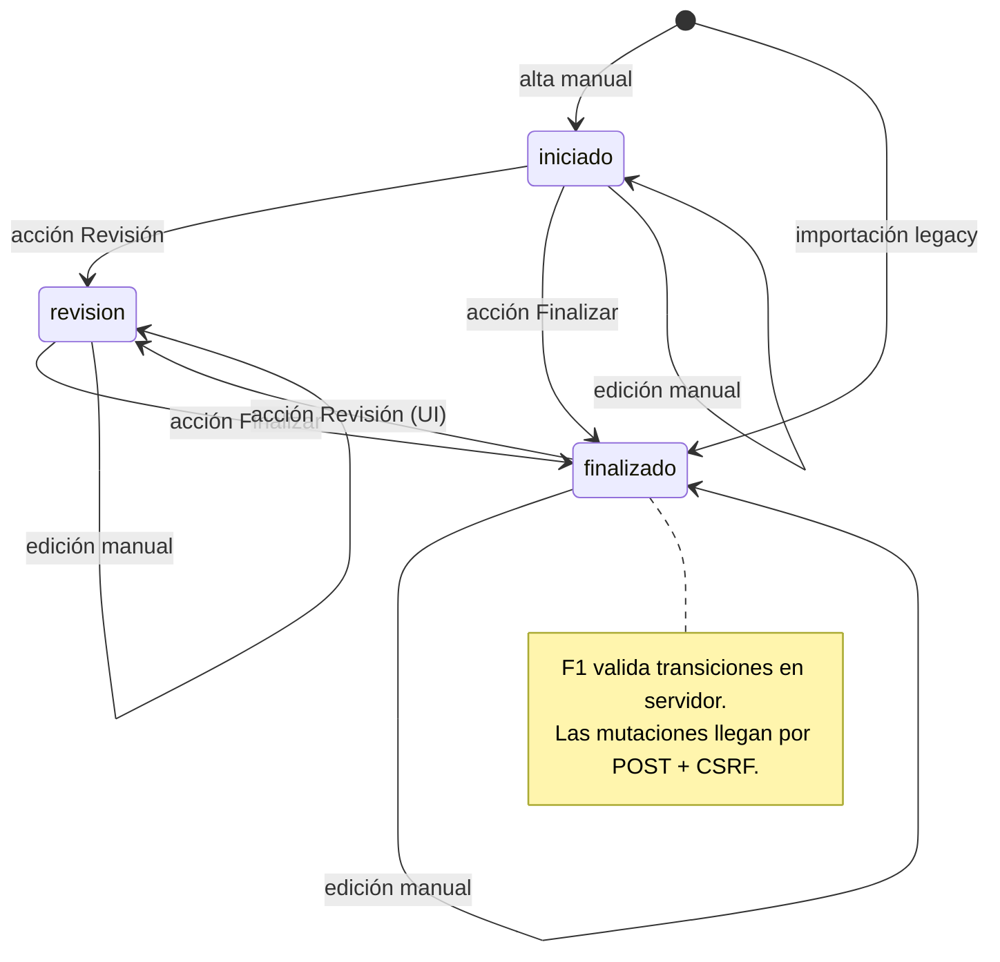
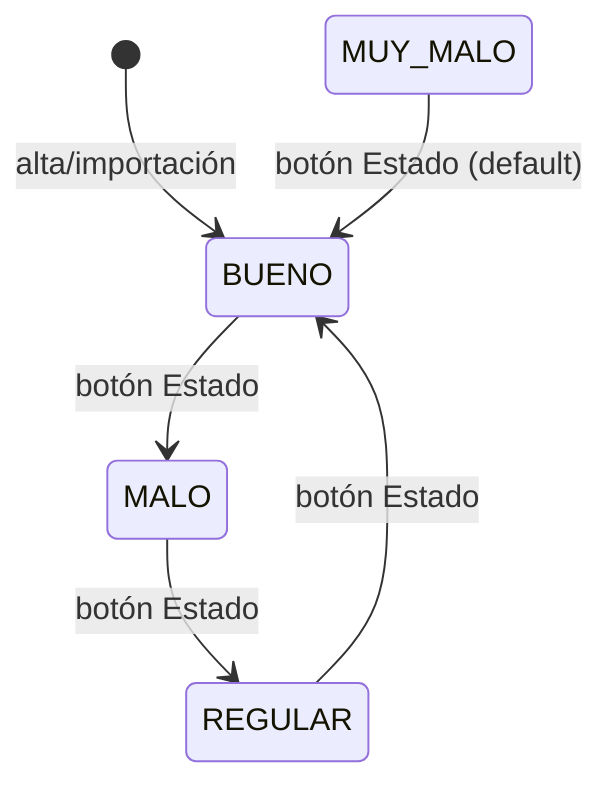
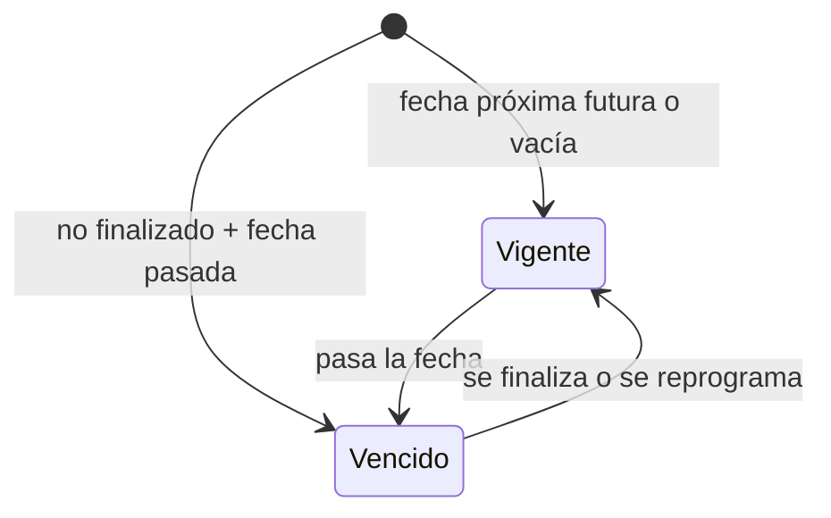

# DOMAIN.md — SysTec GMB

> **Estado:** v1.4 (tickets y flujos compartidos) · **Actualizado:** 2026-11-11.
> Este es el **idioma ubicuo** del sistema: los términos y reglas que deben usarse igual en código, UI, reportes y documentación. Si un término no está aquí, no existe para efectos de diseño.
>
> **Fuente de verdad:** el código actual, los datos de `db.db` y las decisiones aprobadas por el dueño. Las normalizaciones aplicadas se registran en ADR y migraciones.

---

## 1. Glosario de dominio

### 1.1 Bienes e inventario

| Término | Definición | Sinónimos a evitar |
|---|---|---|
| **Bien** | Objeto físico inventariable de la institución (equipo, mobiliario, instalación). Es la unidad central del sistema. | "artículo", "activo", "propiedad" (en UI), "item" |
| **Inventario** | Conjunto de bienes registrados en `properties`. | "lista", "catálogo" (ambiguo con catálogos de estados) |
| **Código de bien** | Identificador visible compuesto: `grupo-subgrupo-seccion-ident`, con relleno de ceros. | "código interno", "ID" (el `id` es la PK técnica) |
| **Grupo** | Primera parte del código; agrupa por familia o categoría mayor. | "categoría" (genérico) |
| **Subgrupo** | Segunda parte del código; subdivisión del grupo. | "subcategoría" |
| **Sección** | Tercera parte del código; ubicación o clasificación interna. | "área", "dependencia" |
| **Ident** | Cuarta parte del código; número identificador dentro de la sección. Es la clave de búsqueda en la importación. | "identificador", "número" |
| **Descripción** | Texto libre que describe el bien. | "nombre" (puede no ser un nombre) |
| **Modelo** | Marca/modelo del bien; en la importación se compone como `marca - modelo`. | "tipo" (el tipo es del mantenimiento) |
| **Serial** | Número de serie del bien. | "serie" (ambigua con series documentales, que aquí no existen) |
| **Color** | Color del bien. | — |
| **Adscripción** | Unidad operativa a la que está asignado el bien. Se obtiene de la dependencia, dirección y departamento registrados en SIA; no es la dirección física del bien. | "ubicación física" |
| **Estado del bien** | Condición física declarada del bien: `BUENO`, `REGULAR`, `MALO`, `MUY MALO`. | "condición" (válido como sinónimo conceptual, pero el campo es `status`) |
| **Bien dañado** | Bien en estado `MALO` o `MUY MALO` con al menos un mantenimiento cuya nota contiene `desincorporación`. | "bien averiado", "bien desincorporado" (la desincorporación es el trámite, no el estado) |
| **Desincorporación** | Proceso administrativo por el cual un bien se retira del inventario. En el sistema se detecta por una nota de texto, no por un estado formal. | "baja", "descarte" |

### 1.2 Mantenimientos

| Término | Definición | Sinónimos a evitar |
|---|---|---|
| **Mantenimiento** | Evento de intervención técnica sobre un bien, con fecha, tipo, técnico, razón, descripción y resultado. | "servicio", "reparación" (solo si es correctivo) |
| **Tipo de mantenimiento** | Categoría de la intervención: `preventivo`, `correctivo`, `predictivo`, `evaluativo`. | "clase", "categoría" |
| **Preventivo** | Mantenimiento planificado para evitar fallas. | "previsivo" (typo) |
| **Correctivo** | Mantenimiento para corregir una falla existente. | "reparación" (válido coloquialmente) |
| **Predictivo** | Mantenimiento basado en condición o pronóstico. | "predictivo" (correcto) |
| **Evaluativo** | Tipo de mantenimiento aprobado por el dueño e incorporado al catálogo de la aplicación. | — |
| **Técnico** | Persona que realizó el mantenimiento. Se guarda como texto libre. | "usuario", "operador" |
| **Fecha de mantenimiento** | Fecha en que se realizó la intervención (`date`). | "fecha de registro" (no existe campo separado) |
| **Razón del mantenimiento** | Motivo o causa de la intervención (`failure_reason`). | "falla" (si es correctivo), "motivo" |
| **Descripción** | Detalle del trabajo realizado (`description`). | "detalle", "observación" (las observaciones son `notes`) |
| **Notas** | Información adicional; incluye la constancia de desincorporación (`notes`). | "observaciones" (válido en UI) |
| **Próximo mantenimiento** | Fecha sugerida para la siguiente intervención (`next_maintenance_date`). | "próxima fecha", "vencimiento" (el vencimiento es la condición, no la fecha) |
| **Vencido** | Mantenimiento no finalizado cuya fecha de próximo mantenimiento ya pasó. | "atrasado", "pendiente" (pendiente no implica vencido) |
| **Historial** | Secuencia cronológica ascendente de mantenimientos de un bien. | "bitácora" (implica auditoría, que no existe) |
| **Horas** | Campo `time_taken`; pretendía medir duración en horas. | "tiempo", "duración" (en UI se muestra "Horas") |

### 1.3 Estados

| Término | Definición | Sinónimos a evitar |
|---|---|---|
| **Estado del mantenimiento** | Etapa del flujo: `iniciado`, `revision`, `finalizado`. | "situación", "fase" |
| **Iniciado** | Mantenimiento registrado, aún no revisado. Estado inicial del alta manual. | "abierto", "pendiente" |
| **Revisión** | Mantenimiento en verificación o control de calidad. | "revisado" (revisado sería el resultado, no el estado) |
| **Finalizado** | Mantenimiento concluido. Estado terminal operativo. | "cerrado", "completado" |
| **Cambio de estado** | Acción que modifica `status` y recalcula `time_taken`. | "transición" (válido técnico) |
| **Estado del bien** | Condición física declarada; se cambia con el botón **Estado**. | "condición" |

### 1.4 Reportes e importación

| Término | Definición | Sinónimos a evitar |
|---|---|---|
| **Dashboard** | Pantalla de inventario con búsqueda, filtros por estado/categoría/adscripción y resumen de mantenimientos y tickets permitidos por rol. | "panel", "home" |
| **Historial imprimible** | Vista por bien con membrete, tabla de mantenimientos y observaciones, pensada para imprimir. | "reporte de bien" (válido) |
| **Reporte de bienes dañados** | Vista que lista bienes en mal estado con notas de desincorporación. | "reporte de bajas" (la baja no es un estado formal) |
| **Lote** | Impresión conjunta de dos historiales en una sola página (`batch.php`). | "batch" (técnico) |
| **Membrete** | Encabezado institucional con oficina, fecha y datos del bien. | "cabecera" (válido UI) |
| **Importación** | Carga masiva desde archivo del usuario, con validación y transacción. | "carga", "migración" (la migración es de esquema) |
| **CSV de inventario** | Archivo delimitado por `;` que se carga desde `/updates.php`. | "archivo de bienes" |
| **Reporte de inventario XLS** | Exportación `.xls` del sistema de bienes, leída como HTML si incluye el formato esperado. | "Excel" (si se desconoce el formato) |
| **CSV de mantenimientos** | `storage/maintenances.csv`, delimitado por `,`. | "archivo de mantenimientos" |
| **Fila omitida** | Fila de importación que no se inserta porque el bien no existe; se reporta en el conteo. | "fila ignorada" |
| **Backup** | Copia manual de `storage/db.db` y CSV en `storage/backups/`. | "respaldo" (válido) |
| **Rol** | Perfil de autorización (`admin`, `operador`, `tecnico`, `consulta`). | "perfil" |
| **CSRF** | Token de sesión exigido en toda mutación por POST. | "token" (válido) |

### 1.5 Tickets

| Término | Definición | Sinónimos a evitar |
|---|---|---|
| **Ticket** | Registro de una incidencia asociada a un bien, con estado e historial de seguimiento. | "mantenimiento" (son entidades distintas) |
| **Seguimiento** | Nota añadida al historial de un ticket por un usuario autorizado. | "auditoría" (el historial de tickets no es una auditoría general) |
| **Baja lógica** | Marca `deleted_at` que oculta el ticket sin borrar su fila ni su historial. | "borrado permanente" |
| **Wizard de ticket** | Formulario en tres pasos: bien, detalles y revisión del resumen antes de guardar. | — |

---

## 2. Entidades principales

### 2.1 Bien (`properties`)

- **Descripción:** objeto inventariable de la institución.
- **Atributos clave:** `id`, `grupo`, `subgrupo`, `seccion`, `ident`, `adscription`, `description`, `model`, `color`, `serial`, `status`.
- **Reglas de negocio:**
  - El código visible se compone de `grupo-subgrupo-seccion-ident` con relleno de ceros.
  - `ident` es la clave de búsqueda de la importación; no hay restricción de unicidad en BD, pero los datos actuales no tienen duplicados.
  - `adscription` sigue vacío en SQLite; el dashboard resuelve en tiempo de consulta la unidad operativa desde `BIEN015` y los catálogos `BIEN001`, `BIEN005` y `BIEN006`.
  - La unidad operativa mostrada es el departamento; si falta su denominación, se usa la dirección y luego la dependencia. Los CSV/XLS actuales no contienen este dato.
  - `status` no se deriva de los mantenimientos; se cambia manualmente.
  - Un bien puede no tener mantenimientos (450 de 617 en el snapshot).
  - No se elimina un bien desde la aplicación.
- **Relaciones:** 1:N lógica con `maintenances` por `id`/`property_id`; sin FK física.

### 2.2 Mantenimiento (`maintenances`)

- **Descripción:** intervención técnica sobre un bien.
- **Atributos clave:** `id`, `property_id`, `code`, `type`, `description`, `date`, `time_taken`, `technician`, `next_maintenance_date`, `failure_reason`, `notes`, `status`.
- **Reglas de negocio:**
  - Pertenece a un bien por `property_id`.
  - `code` es un snapshot del código del bien al registrar/editar/importar; puede quedar obsoleto si cambia el bien.
  - El alta manual nace en `iniciado`; la importación nace en `finalizado`.
  - `time_taken` se calcula al pasar a `finalizado` como diferencia total en horas; la importación lo deja nulo. Los valores históricos se conservaron porque no hay fechas de inicio/fin para recalcularlos.
  - `next_maintenance_date` puede ser `NULL`.
  - `notes` es el único lugar donde se registra la desincorporación.
  - No se elimina un mantenimiento desde la aplicación.
- **Relaciones:** N:1 lógica con `properties`; sin FK física.

### 2.3 Técnico (implícito)

- **Descripción:** persona que realiza el mantenimiento. No es una entidad separada; es texto en `maintenances.technician`.
- **Atributos:** nombre de usuario (`ndominguez`).
- **Reglas:**
  - El catálogo de técnicos está hardcodeado en `DB::getListMaintenanceTechnician()`.
  - La migración F2 corrigió `ndomiguez` a `ndominguez`; el campo continúa siendo texto libre.
  - No hay alta, baja ni asignación de técnicos.
- **Relaciones:** 1:N lógica con `maintenances`.

### 2.3.1 Usuario (`users`)

- **Descripción:** cuenta que accede al sistema; introducida en F1.
- **Atributos:** `id`, `username`, `password_hash`, `role`, `active`, `created_at`.
- **Reglas:**
  - `username` es único; la contraseña se guarda con `password_hash`.
  - Roles: `admin`, `operador`, `tecnico`, `consulta`, `personal`.
  - `active=0` impide el login; no hay UI de baja.
  - La gestión es por CLI (`bin/create-user.php`).
- **Relaciones:** no se relaciona con mantenimientos; el técnico sigue siendo texto.

### 2.3.2 Ticket (`tickets`)

- **Atributos clave:** `id`, `property_id`, `status_id`, `title`, `description`, `observation`, `created_by`, `assigned_to`, `created_at`, `updated_at`, `closed_at`, `deleted_at`.
- **Relaciones lógicas:** cada ticket corresponde a un bien y a un usuario creador; puede tener un usuario asignado, estado y múltiples eventos en `ticket_histories`. Las tablas no declaran claves foráneas físicas.
- **Registro:** se exige un bien existente, título y descripción no vacíos; la observación es opcional. Se inicia con estado `iniciado` y se escribe un evento `created`.
- **Wizard compartido:** tanto `/tickets.php` como `/personal/index.php` muestran el modal reutilizable de tres pasos. El selector consulta bienes y direcciones, permite filtrar por categoría/dirección y buscar por código/descripción.
- **Acceso:** `admin`, `operador` y `tecnico` acceden a la bandeja de soporte; `personal` registra y consulta únicamente tickets propios dentro de `/personal/`.
- **Baja lógica:** solo `admin` y `operador` pueden dar de baja desde soporte. `deleted_at` oculta el ticket y bloquea su seguimiento; la fila y el historial se conservan.
- **Trazabilidad:** el alta, los seguimientos, cambios de estado y baja agregan eventos en `ticket_histories`; no es una auditoría general de cambios de la aplicación.
- **Estados:** `iniciado`, `en_progreso`, `con_retraso`, `en_espera` y `finalizado`; este último está marcado como terminal en `ticket_status`.
- **Restauración:** no existe una acción de restauración desde la interfaz.

### 2.4 Reporte (derivado)

- **Descripción:** salida HTML imprimible; no se persiste.
- **Tipos:** historial por bien, reporte de bienes dañados, lote de dos historiales.
- **Reglas:**
  - Se genera en el momento a partir de los datos vivos.
  - No hay snapshot, hash, versión ni auditoría de lo impreso.
  - La impresión usa el diálogo del navegador; no hay PDF generado por el servidor.

---

## 3. Reglas de negocio globales

1. **El bien es la raíz.** Todo mantenimiento debe referenciar un bien; si el bien no existe, la fila de importación se omite.
2. **El código visible es compuesto y con ceros.** `getCodeId()` es la fuente de verdad para mostrarlo.
3. **El estado del bien es manual.** No se deriva de mantenimientos ni de vencimientos.
4. **El estado del mantenimiento tiene guardia en servidor y SQLite.** Solo se permiten `iniciado→revision`, `iniciado→finalizado`, `revision→finalizado` y `finalizado→revision`; triggers rechazan estados y transiciones inválidos.
5. **El vencimiento es una condición calculada, no un campo.** Se evalúa al renderizar la tabla.
6. **La desincorporación es una nota, no un estado.** El reporte de dañados depende de un `LIKE '%desincorporación%'`.
7. **La importación de inventario es un upsert parcial.** Si el bien existe, solo se actualiza `status`.
8. **Las importaciones son transaccionales y limitadas.** Requieren POST + confirmación, reportan cada fila y aceptan hasta 5000 filas/5 MB. La importación de inventario actualiza solo estado en bienes existentes.
9. **`time_taken` mide horas totales al finalizar.** La importación lo deja nulo; los 15 nulos históricos se conservan.
10. **Hay identidad y autorización, pero no auditoría.** Toda mutación exige sesión, rol y CSRF; no queda bitácora de cambios.
11. **La fecha de negocio se interpreta en `America/Caracas`.** El cálculo de horas usa timestamps absolutos.
12. **Los reportes se generan desde datos vivos.** No hay reproducibilidad histórica.
13. **Los tickets están vinculados a un bien.** La selección visual no reemplaza la validación del bien en el servidor.
14. **El historial del ticket conserva eventos funcionales.** No sustituye una auditoría global de cambios.

---

## 4. Estados y transiciones

### 4.1 Estado del mantenimiento

**Regla:** `finalizado` es el estado terminal operativo, pero la UI permite volver a `revision`. Los datos se normalizaron a minúsculas; SQLite aplica las transiciones válidas.

### 4.2 Estado del bien

**Regla:** el ciclo no es una escala lineal. `MUY MALO` y `MUY BUENO` no tienen transición propia y caen a `BUENO`.

### 4.3 Vencimiento

**Regla:** el vencimiento se calcula en la vista; no se persiste.

---

## 5. Casos límite conocidos

| Caso | Tratamiento actual | Riesgo |
|---|---|---|
| Bien sin mantenimientos | Aparece con conteo 0 | Correcto |
| Mantenimiento con bien inexistente | No ocurre en datos actuales; la importación lo omite | Pérdida silenciosa |
| Estado `FINALIZADO` previo | Normalizado a `finalizado` | Resuelto por F2 |
| Tipo `evaluativo` | Aprobado e incluido en catálogo/UI/BD | Resuelto por F2 |
| Estado `MUY BUENO` previo | Dos registros mapeados a `BUENO` por decisión aprobada | Resuelto por F2 |
| Técnico `ndomiguez` previo | Normalizado a `ndominguez` | Resuelto por F2 |
| Fecha con formato `T` | Convertida a `YYYY-MM-DD HH:MM:SS` | Resuelto por F2 |
| Mantenimiento de más de 24 h | `time_taken` acumula horas totales al finalizar | Correcto desde F1 |
| Cambio de estado a `revision` | No recalcula `time_taken`; solo se calcula al finalizar | Correcto desde F1 |
| Bien `MALO` sin nota de desincorporación | No aparece en el reporte de dañados | Reporte incompleto |
| Bien con varias notas de desincorporación | Reporte usa `SELECT DISTINCT` | Resuelto por F2 |
| Importación de un CSV con fila inválida | Se reporta por fila; transacción confirma los registros válidos | Sin escritura parcial de una fila inválida |
| Dos usuarios editan el mismo mantenimiento | El último gana | Pérdida de cambios |
| Acceso directo a `storage/db.db` | Denegado por `router.php`/`.htaccess` (403) | Correcto desde F1 |
| Borrado accidental de `storage/db.db` | Restore manual desde `storage/backups/2025-04-09/` | Pérdida de datos posteriores a abril 2025 |

---

## 6. Anexo: invariantes → pruebas recomendadas

| Invariante | Prueba recomendada | Estado |
|---|---|---|
| Todo mantenimiento referencia un bien existente | Test de integridad + FK | No existe |
| El código visible siempre tiene el mismo formato | Test unitario de `getCodeId` | No existe |
| `status` de mantenimiento pertenece al catálogo | Test de validación + CHECK | No existe |
| `type` pertenece al catálogo | Test de validación + CHECK | No existe |
| `status` de bien pertenece al catálogo | Test de validación + CHECK | No existe |
| Vencido = no finalizado + fecha pasada | Test de cálculo puro | No existe |
| Importación reporta filas omitidas | Test de importación con bien inexistente | No existe |
| Reporte de dañados no duplica bienes | Test de consulta con múltiples mantenimientos | No existe |
| `time_taken` refleja duración total | Test de diferencia de fechas > 24 h | No existe |
| El último cambio de estado queda auditado | Test de auditoría (requiere modelo nuevo) | No existe |

---

> Idioma ubicuo vinculante: si un término no está aquí, no existe para diseño. Ver también: `README.md`, `PROJECT.md`, `ARCHITECTURE.md`, `DATABASE.md`, `API.md`, `TODO.md`, `grafo/logica-negocio.md`.
