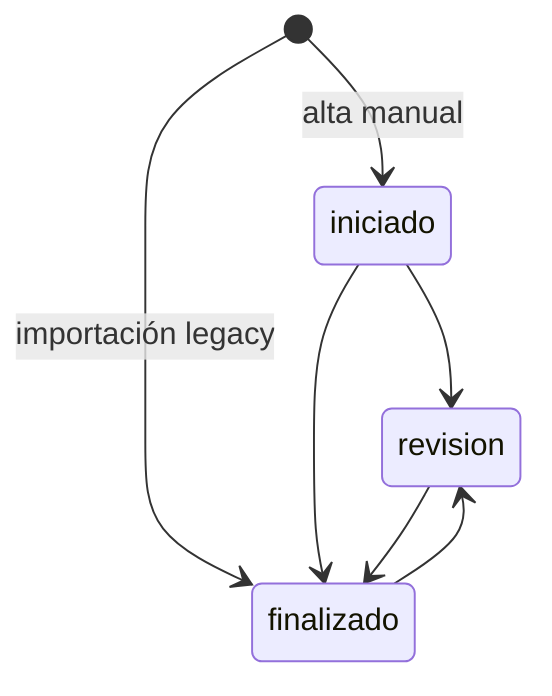
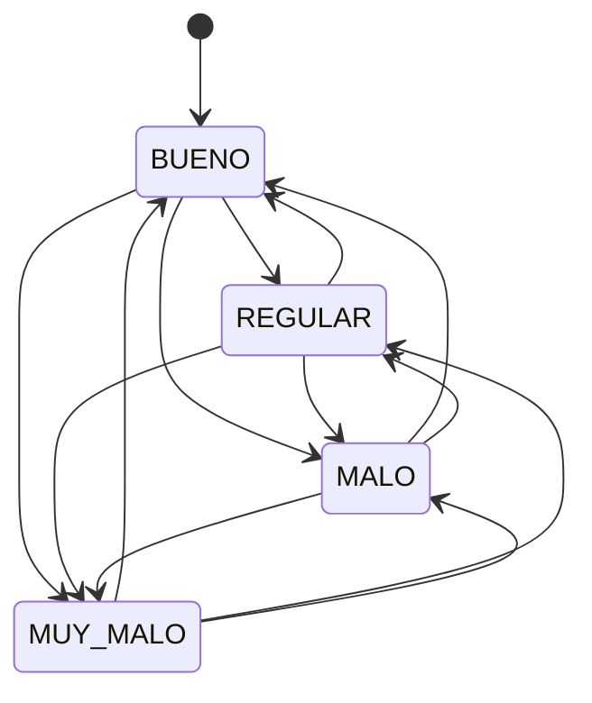
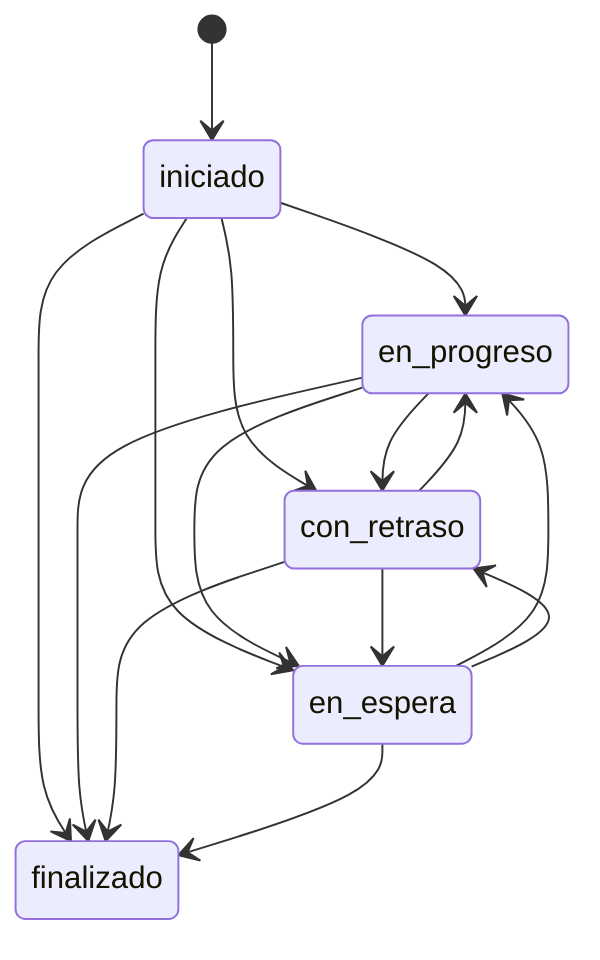
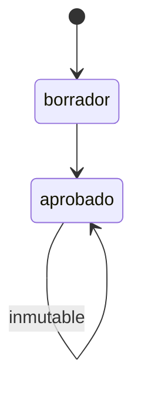

# DOMAIN.md — SysTec GMB

> **Estado:** v1.6 (inventario, mantenimientos, tickets, usuarios/perfiles e informes de rendición) · **Actualizado:** 2026-11-26.
> Este es el **idioma ubicuo** del sistema. Los términos y reglas deben usarse igual en código, UI, reportes y documentación.
> **Fuente de verdad:** código actual, `storage/db.db`, migraciones y decisiones registradas.

---

## 1. Glosario de dominio

### 1.1 Bienes e inventario

| Término | Definición | Sinónimos a evitar |
|---|---|---|
| **Bien** | Objeto físico inventariable de la institución. Unidad central del sistema. | "artículo", "activo", "propiedad" en UI |
| **Inventario** | Conjunto de bienes registrados en `properties`. | "lista" |
| **Código de bien** | `grupo-subgrupo-seccion-ident`, con relleno de ceros. | "ID" |
| **Grupo / Subgrupo / Sección / Ident** | Partes jerárquicas del código; `ident` identifica el bien dentro de la sección. | "categoría" cuando se refiere al código |
| **Descripción / Modelo / Serial / Color** | Datos descriptivos del bien. | "nombre" para descripción |
| **Adscripción** | Unidad operativa institucional. Se importa/sincroniza a SQLite y también puede resolverse desde la caché legacy. | "ubicación física" |
| **Responsable del bien** | Nombre y estado sincronizados desde la fuente legacy. No es una cuenta de usuario. | "dueño" |
| **Usuario asignado al bien** | Nombre y estado de la persona asignada al bien en la fuente legacy. No equivale a `tickets.assigned_to`. | "técnico del ticket" |
| **Estado del bien** | Condición física: `BUENO`, `REGULAR`, `MALO`, `MUY MALO`. | "condición" como nombre de campo |
| **Bien dañado** | Bien `MALO` o `MUY MALO` con al menos una nota que contiene `desincorporación`. | "baja" |
| **Desincorporación** | Trámite administrativo detectado por texto en `notes`; no es un estado formal. | "borrado" |

### 1.2 Mantenimientos

| Término | Definición | Sinónimos a evitar |
|---|---|---|
| **Mantenimiento** | Intervención técnica sobre un bien, con fecha, tipo, técnico, razón, descripción, notas, horas y estado. | "servicio" |
| **Tipo** | `preventivo`, `correctivo`, `predictivo`, `evaluativo`. | "clase" |
| **Técnico** | Persona que realizó el mantenimiento. El campo almacenado es texto libre. | "usuario" |
| **Catálogo de técnicos** | Lista híbrida: históricos base más usuarios activos con rol `tecnico`. | "tabla relacional de técnicos" |
| **Fecha de mantenimiento** | Fecha de la intervención (`date`). | "fecha de registro" |
| **Razón** | Motivo o causa (`failure_reason`). | "descripción" |
| **Descripción** | Detalle del trabajo (`description`). | "notas" |
| **Notas** | Información adicional (`notes`); incluye la constancia de desincorporación. | "observaciones" |
| **Próximo mantenimiento** | Fecha sugerida (`next_maintenance_date`). | "vencimiento" |
| **Vencido** | Mantenimiento no finalizado cuya fecha próxima ya pasó. | "pendiente" |
| **Historial** | Secuencia cronológica de mantenimientos y tickets de un bien. | "auditoría" |
| **Horas** | `time_taken`, calculado al finalizar como horas totales redondeadas. | "minutos" |

### 1.3 Usuarios, roles y perfiles

| Término | Definición | Sinónimos a evitar |
|---|---|---|
| **Usuario** | Cuenta de acceso en `users`, identificada por `username`. | "login" |
| **Username** | Identificador de inicio de sesión; único, 3–64 caracteres en el alta. | "email" |
| **Email** | Correo institucional opcional. Se muestra/exporta, pero no se edita en el drawer ni se usa para login/recuperación. | "usuario" |
| **Rol** | Perfil de autorización: `admin`, `operador`, `tecnico`, `consulta`, `personal`. | "perfil de usuario" |
| **Perfil de usuario** | Datos de presentación en `profile`: nombre, apellidos y URL de avatar. | "rol" |
| **Nombre** | Primer nombre (`first_name`). | "username" |
| **Apellidos** | Apellidos (`last_name`); en el seed se toman los dos últimos tokens del nombre completo. | "segundo nombre" |
| **Avatar** | Imagen referenciada por URL `http/https`; no es una carga de archivo. | "foto adjunta" |
| **Cuenta activa** | `active=1`; puede iniciar sesión. | "sesión vigente" |
| **Sesión** | Estado autenticado que conserva `id`, `username` y `role` al entrar. | "cuenta activa" |
| **Desbloqueo** | Limpieza del contador de intentos fallidos del usuario. No necesariamente limpia el contador por IP. | "reactivación" |

### 1.4 Estados

| Término | Definición |
|---|---|
| **Estado del mantenimiento** | `iniciado`, `revision`, `finalizado`. |
| **Estado del bien** | `BUENO`, `REGULAR`, `MALO`, `MUY MALO`; se selecciona explícitamente. |
| **Estado del ticket** | `iniciado`, `en_progreso`, `con_retraso`, `en_espera`, `finalizado`. No forman una secuencia obligatoria. |
| **Estado del informe** | `borrador` o `aprobado`; un informe aprobado es inmutable. |

### 1.5 Tickets, reportes e importación

| Término | Definición | Sinónimos a evitar |
|---|---|---|
| **Ticket** | Incidencia asociada a un bien, con estado e historial. | "mantenimiento" |
| **Seguimiento** | Nota añadida al historial por un usuario autorizado. | "auditoría general" |
| **Baja lógica** | `deleted_at`; oculta el ticket sin borrar la fila ni su historial. | "borrado permanente" |
| **Wizard de ticket** | Drawer de tres pasos: bien, detalles y resumen. | "modal" |
| **Portal Personal** | Área donde el rol `personal` crea y consulta únicamente sus tickets. | "bandeja global" |
| **Historial imprimible** | HTML por bien o conjunto filtrado, con mantenimientos y tickets. | "snapshot" |
| **Reporte de bienes dañados** | Bienes `MALO`/`MUY MALO` con nota de desincorporación. | "reporte de bajas" |
| **Informe de Rendición** | Reporte persistente por período y alcance, con Markdown, borrador/aprobado y aprobación. | "reporte legacy" |
| **Alcance del informe** | Conjunto de filtros, fechas y parámetros que identifica el informe mediante `scope_hash`. | "versión" |
| **Lote** | Acción masiva sobre mantenimientos; omite los registros que no admiten la transición. | "transacción de lote" |
| **Importación** | Carga masiva validada y transaccional desde CSV/XLS/PostgreSQL. | "migración de esquema" |
| **Migración** | Evolución SQL versionada registrada en `schema_migrations`. | "importación" |
| **Backup** | Snapshot consistente de SQLite y fuentes auxiliares. | "copia en caliente del archivo" |

---

## 2. Entidades principales

### 2.1 Bien (`properties`)

- **Atributos:** `id`, `grupo`, `subgrupo`, `seccion`, `ident`, `adscription`, `description`, `model`, `color`, `serial`, `status`, `responsible_name`, `responsible_status`, `assigned_name`, `assigned_status`.
- **Reglas:**
  - El código visible se compone con relleno de ceros.
  - `ident` es la clave de importación; no hay restricción `UNIQUE` en BD.
  - `status` no se deriva de mantenimientos; se selecciona en un modal y se envía por POST con CSRF.
  - Las asignaciones se sincronizan desde PostgreSQL y se guardan en SQLite/caché.
  - No se elimina un bien desde la aplicación.
- **Relaciones:** 1:N lógica con mantenimientos y tickets.

### 2.2 Mantenimiento (`maintenances`)

- **Atributos:** `id`, `property_id`, `ticket_id`, `code`, `type`, `description`, `date`, `time_taken`, `technician`, `next_maintenance_date`, `failure_reason`, `notes`, `status`.
- **Reglas:**
  - `ticket_id` es opcional; si existe, debe ser un ticket activo del mismo bien.
  - El alta manual nace en `iniciado`; la importación nace en `finalizado`.
  - `time_taken` se calcula al finalizar; la importación lo deja nulo.
  - Las transiciones se validan en servidor y con triggers.
  - Las acciones masivas omiten transiciones inválidas y no son atómicas como lote.
- **Relaciones:** N:1 lógica con `properties` y, opcionalmente, `tickets`.

### 2.3 Usuario (`users`) y Perfil (`profile`)

- **Usuario:** `id`, `username`, `email`, `password_hash`, `role`, `active`, `created_at`.
- **Perfil:** `id`, `user_id`, `first_name`, `last_name`, `avatar_url`.
- **Reglas:**
  - Un usuario tiene como máximo un perfil; `profile.user_id` es `UNIQUE` y FK con `ON DELETE CASCADE`.
  - Nombre y apellidos se guardan juntos; cada uno admite hasta 120 caracteres.
  - El avatar admite hasta 2048 caracteres y debe ser URL `http/https`.
  - Si se dejan nombre y apellidos vacíos al editar, se conserva el perfil existente.
  - El drawer no edita email; las cuentas nuevas web/CLI no lo reciben automáticamente.
  - La cuenta y el perfil se guardan en una transacción.
  - El administrador no puede desactivar, eliminar ni degradar su propia cuenta en sesión.
  - No se puede eliminar el último administrador activo.
  - Desactivar o eliminar una cuenta no invalida por sí solo una sesión ya abierta.
- **Gestión:** `/users.php` para administradores; `bin/create-user.php` y `bin/seed-profiles.php` para operación CLI.

### 2.4 Ticket (`tickets`)

- **Atributos:** `id`, `property_id`, `status_id`, `title`, `description`, `observation`, `created_by`, `assigned_to`, `created_at`, `updated_at`, `closed_at`, `deleted_at`.
- **Reglas:**
  - Se exige un bien existente, título y descripción.
  - Nace en `iniciado` y escribe un evento `created`.
  - `assigned_to` queda en `NULL`; el filtro “usuario asignado” se refiere al bien, no al ticket.
  - No existe edición del contenido después del alta; los cambios se documentan con seguimientos.
  - `admin`, `operador` y `tecnico` gestionan la bandeja; `consulta` aparece en el listado/drawer, pero el detalle completo y las acciones lo rechazan. Esta inconsistencia está pendiente de decisión.
  - `personal` solo crea/consulta/amplía sus tickets no finalizados.
  - La baja lógica se limita a `admin`/`operador`.
- **Trazabilidad:** `ticket_histories` registra actor, fecha, descripción y estados. El alta de soporte todavía no envuelve ticket + evento inicial en una transacción explícita; el alta personal y los seguimientos/cambios de estado sí.

### 2.5 Informe de Rendición (`rendition_reports`)

- **Atributos:** período, título, `scope_hash`, filtros/parámetros/estadísticas JSON, IDs de mantenimientos/tickets, Markdown, `ai_generated`, estado, creador/aprobador y timestamps.
- **Reglas:**
  - Administrador, Operador y Técnico pueden generar y guardar borradores/aprobados.
  - Consulta puede consultar la impresión por URL, pero no generar/guardar desde la UI.
  - Solo Administrador elimina informes.
  - El par período + `scope_hash` es único.
  - Un informe `aprobado` es inmutable.
  - Se puede imprimir o descargar como `.md`.

---

## 3. Reglas de negocio globales

1. El bien es la raíz de mantenimientos y tickets.
2. El estado del bien es manual y se selecciona explícitamente; no es un ciclo automático.
3. Las transiciones de mantenimiento están limitadas por servidor y SQLite.
4. El vencimiento se calcula en la vista: no finalizado + fecha próxima pasada.
5. La desincorporación es una nota, no un estado.
6. Las importaciones son transaccionales y limitadas a 5000 filas/5 MB; los bienes existentes normalmente solo actualizan su estado.
7. `time_taken` mide horas totales redondeadas al finalizar; los históricos no se reconstruyen sin fuente.
8. Toda mutación exige sesión, rol y CSRF; no existe auditoría general `audit_events`.
9. La fecha de negocio se interpreta en `America/Caracas`.
10. Los reportes legacy se generan desde datos vivos; los Informes de Rendición sí se persisten.
11. El personal solo accede a tickets donde `created_by` coincide con su usuario.
12. Un perfil pertenece a un único usuario y se elimina en cascada con la cuenta.
13. El avatar es una URL remota validada; su carga puede generar solicitudes a terceros.
14. El núcleo funciona sin internet; IA y avatares remotos son opcionales.

---

## 4. Estados y transiciones

### 4.1 Mantenimiento

### 4.2 Bien

El servidor valida el estado destino y lo aplica de forma idempotente. No hay ciclo ni transición automática.

### 4.3 Ticket

El servidor acepta estados del catálogo; no impone la secuencia del diagrama. `finalizado` está marcado como terminal y bloquea seguimientos personales.

### 4.4 Informe de Rendición

---

## 5. Casos límite conocidos

| Caso | Tratamiento actual | Riesgo / pendiente |
|---|---|---|
| Bien sin mantenimientos | Conteo 0 | Correcto |
| Ticket eliminado | Se excluye de bandeja activa; puede aparecer en historial del bien | Conservación de trazabilidad |
| Consulta abre ticket global | Listado/drawer disponibles; detalle completo y acciones devuelven 403 | Política inconsistente |
| Sesión abierta tras desactivar cuenta | La sesión conserva rol y puede continuar | Revocación centralizada pendiente |
| Perfil sin nombre/apellidos | No se crea; si se vacían al editar, se conserva el existente | No hay borrado manual de perfil |
| Avatar remoto caído | Navegador muestra error; no hay proxy ni caché de imagen | Dependencia de terceros |
| Seeder con username canónico ausente | Revierte toda la operación | La DB actual tiene `abrizuela` en vez de `abrizzuela` |
| Informe aprobado | No se puede modificar ni eliminar salvo decisión de administrador sobre borrador | Inmutabilidad implementada |
| Cambio masivo de mantenimiento | Omite registros inválidos | Lote no atómico |
| Importación con caché legacy fallida | Los datos pueden quedar guardados y se muestra advertencia | Refresco no garantizado |
| Restore de backup previo a 009 | Puede fallar con el código actual | Restaurar aislado y aplicar migraciones 001–011 |

---

## 6. Invariantes → pruebas existentes

| Invariante | Evidencia de prueba | Estado |
|---|---|---|
| Transiciones de mantenimiento válidas | `SecurityAndTransitionsTest` | Cubierto |
| Catálogos de estados/tipos | `SecurityAndTransitionsTest`, `HelpersTest` | Cubierto |
| `time_taken` usa horas totales | `HelpersTest`, pruebas de repositorio | Cubierto |
| Importación reporta omitidas y conserva transacción | `InventoryImportTest` | Cubierto |
| Tickets personales quedan limitados al creador | `PersonalTicketQueryTest` | Cubierto |
| Perfil único y cascada | `ProfileMigrationTest` | Cubierto |
| Usuario/perfil se guardan juntos y revierten ante fallo | `UserProfileManagementTest` | Cubierto |
| Seeder idempotente y conserva avatar | `ProfileSeederCommandTest` | Cubierto |
| Username canónico coincide con datos productivos | No hay prueba de cadena completa | Pendiente; `abrizuela`/`abrizzuela` |
| FK de mantenimientos/tickets | No declarada | Pendiente |
| Auditoría general | No existe `audit_events` | Pendiente |
| Flujos HTTP E2E | Suite principalmente unitaria/in-memory | Pendiente |

---

Ver también: `PROJECT.md`, `ARCHITECTURE.md`, `DATABASE.md`, `API.md`, `SECURITY.md`, `TODO.md`, `grafo/logica-negocio.md`.
