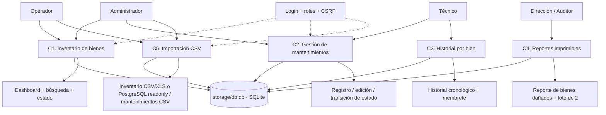
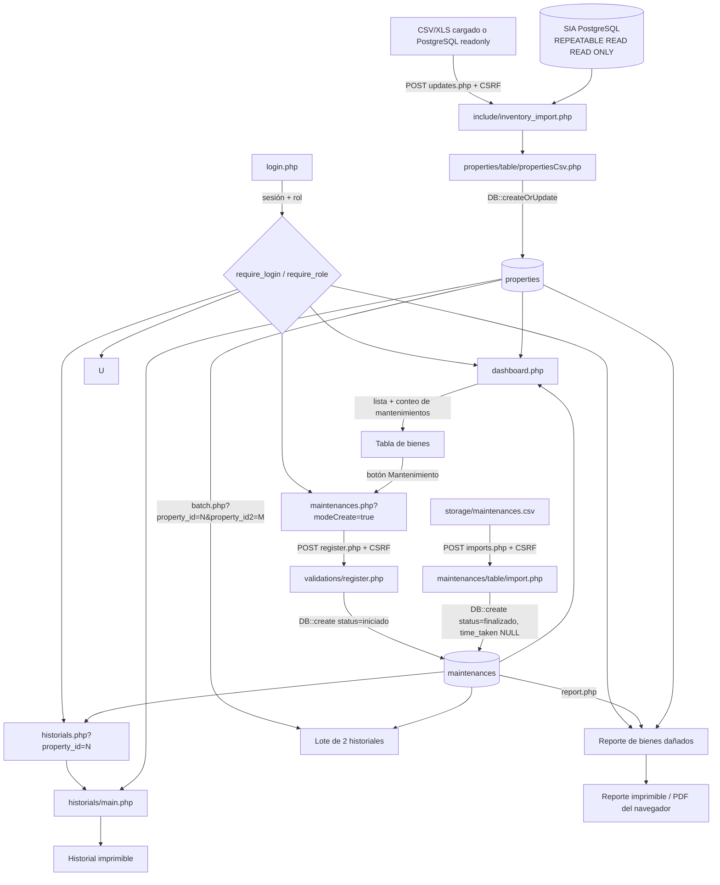
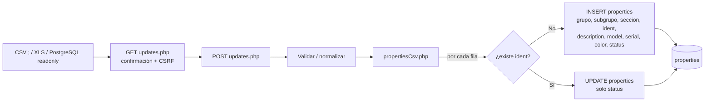
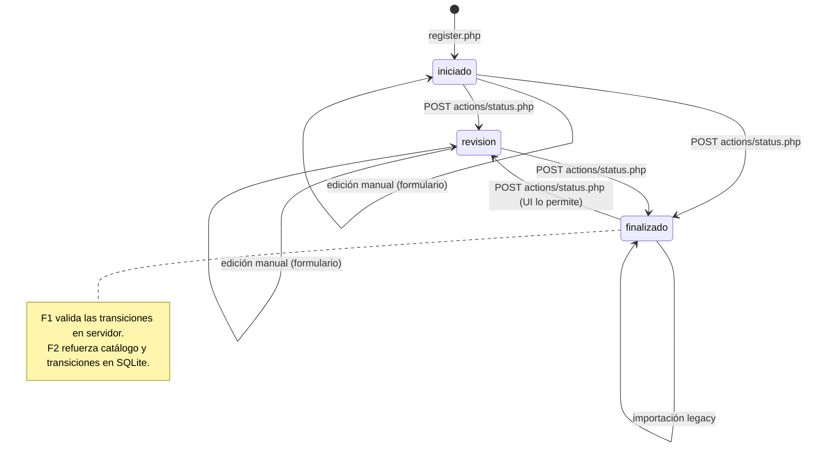
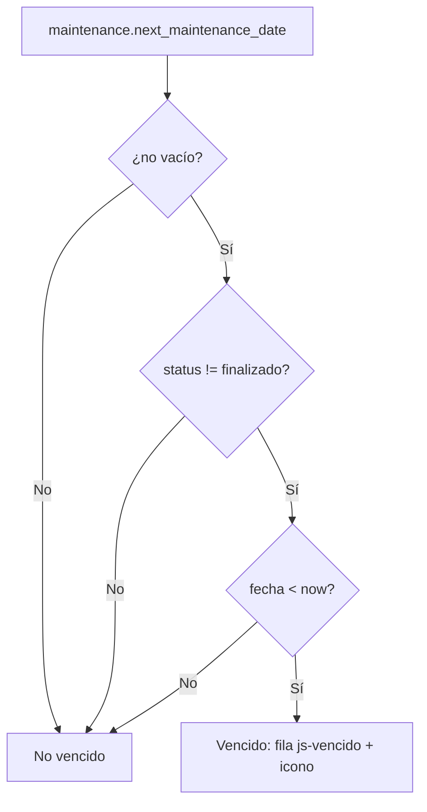
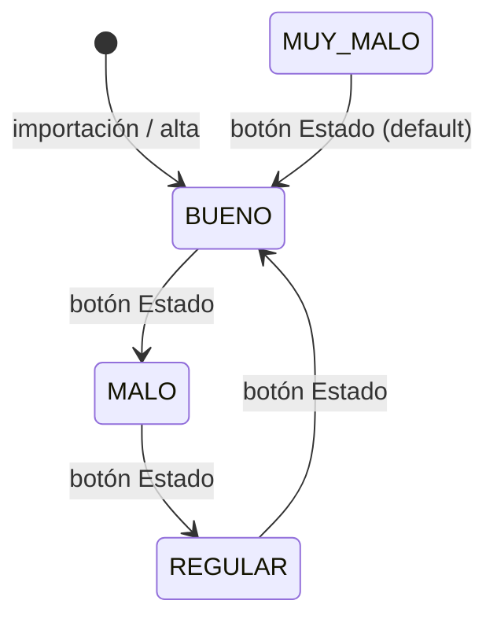
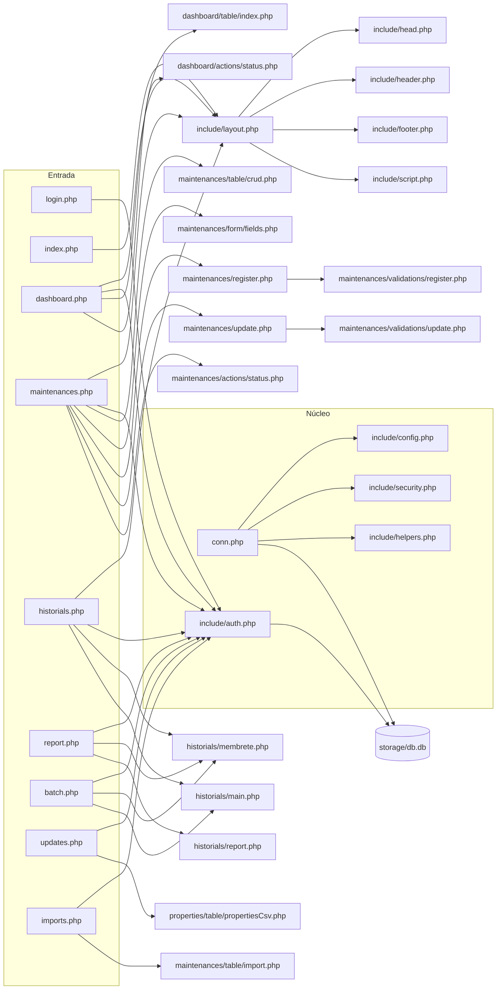

# Lógica de negocio — SysTec GMB

> **Sistema:** Gestión de Mantenimientos de Bienes (GMB) de la Oficina de Informática, San Felipe, Edo. Yaracuy.
> **Alcance:** inventario de bienes, registro y seguimiento de mantenimientos, historial por bien, reporte de bienes dañados e importación de datos legacy.
> **Fecha de análisis:** 2026-11-09 (actualizado tras F2).
> **Nota de vigencia:** F1 agregó controles de aplicación; F2 agregó importaciones transaccionales, normalización, migraciones, triggers e índices. Los datos se respaldaron antes de normalizar.

---

## 1. Contexto

La institución mantiene un inventario de bienes (equipos, mobiliario, instalaciones) identificados por un código compuesto. Cada bien acumula mantenimientos preventivos, correctivos o predictivos. El sistema debe permitir:

1. Consultar el inventario y su estado.
2. Registrar un mantenimiento y su resultado.
3. Consultar el historial completo de un bien.
4. Producir un reporte imprimible de bienes dañados y desincorporados.
5. Cargar inventario y mantenimientos históricos desde archivos CSV.

No hay API pública ni framework. El sistema es una aplicación PHP monolítica que escribe sobre un archivo SQLite en `storage/db.db` (fuera del webroot lógico). Desde F1 exige sesión, aplica roles y protege las mutaciones con CSRF; F2 valida catálogos y transiciones en SQLite. No hay auditoría de cambios.

---

## 2. Actores

| Actor | Rol / permiso | Qué hace | Dónde |
|---|---|---|---|
| **Administrador** | `admin` | Todo: inventario, mantenimientos, importación y estado | Todas las rutas |
| **Operador de inventario** | `operador` | Carga CSV, consulta dashboard, cambia el estado de un bien | `updates.php`, `dashboard.php` |
| **Técnico / encargado de mantenimiento** | `tecnico` | Registra, edita y cambia el estado de mantenimientos | `maintenances.php` |
| **Dirección / auditor** | `consulta` | Consulta historiales y reportes imprimibles; no muta | `historials.php`, `report.php`, `batch.php` |
| **Sistema** | — | Calcula códigos, vencimientos, horas y genera HTML | `conn.php`, `include/helpers.php` |

> Desde F1 toda ruta de aplicación exige `require_login()`; las mutaciones exigen rol y token CSRF. Los usuarios se gestionan por CLI (`bin/create-user.php`). Ver `docs/SECURITY.md`.

---

## 3. Mapa de capacidades



| Capacidad | Estado | Implementación principal |
|---|---|---|
| C1 Inventario | Operativa, con auth | `dashboard.php`, `dashboard/table/index.php`, `dashboard/actions/status.php` |
| C2 Mantenimientos | Operativa; datos F2 normalizados | `maintenances.php`, `maintenances/register.php`, `maintenances/update.php`, `maintenances/actions/status.php` |
| C3 Historial | Operativa, con auth | `historials.php`, `historials/main.php`, `historials/report.php` |
| C4 Reportes | Operativa, con auth | `report.php`, `batch.php` |
| C5 Importación | POST, confirmación, transacción, límite 5000 filas/5 MB; inventario en CSV, XLS o PostgreSQL readonly | `updates.php`, `imports.php`, `include/inventory_import.php`, `include/csv_import.php` |

---

## 4. Flujo principal: inventario → mantenimiento → historial



---

## 5. Flujo de importación

### 5.1 Inventario (CSV, XLS o PostgreSQL)



Reglas observadas:

- La ruta exige rol `admin` u `operador`; la importación se dispara por POST con token CSRF.
- PostgreSQL se consulta dentro de una transacción `REPEATABLE READ READ ONLY`; se exige el formato verificado de empresa `38` y se filtra `BIEN015.desincorporado = 'N'`.
- El CSV usa delimitador `;`; el reporte XLS exportado como HTML se reconoce por sus encabezados y se normaliza al formato de 11 columnas.
- Para empresa 38, el código se compone de grupo (posición 1 de `cod_clasificacion`), subgrupo (posiciones 3–6), sección (8–10) e identificador (`num_bien`); se valida contra `cod_bien_mue`.
- La identidad del bien para la búsqueda en SysTec es `ident` (columna 3 del formato normalizado); la fuente se cancela si contiene identificadores duplicados.
- Si el bien no existe, se crea con los campos del CSV. `adscription` **nunca** se carga.
- Si el bien existe, **solo se actualiza `status`**; el resto de los campos se ignora silenciosamente.
- `subgrupo` y `seccion` se rellenan con `str_pad` a 4 y 3 dígitos respectivamente al insertar.
- En el XLS, `CODIGO` debe tener cuatro segmentos numéricos; `MUY BUENO` se normaliza como `BUENO`. `MATERIAL` y `COLOR` se preservan en la descripción; `VALOR INCORP.` no se almacena porque no existe un campo equivalente.
- Desde PostgreSQL también se incorpora `caracteristicas` en la descripción y se lee el estado desde el catálogo `BIEN004`; para bienes ya existentes se conserva la regla de actualizar solo el estado.
- `model` combina `marca` y `modelo` con ` - `, omitiendo los segmentos vacíos; `serial` toma `dataCsv[7]`.
- La página reporta filas procesadas y errores dentro de una transacción; límite de 5000 filas y 5 MB.

### 5.2 Mantenimientos (`storage/maintenances.csv`)

```mermaid
flowchart LR
    F[storage/maintenances.csv<br/>separador ,] --> G[GET imports.php<br/>confirmación + CSRF]
    G --> I[POST imports.php]
    I --> T[maintenances/table/import.php]
    T -->|por cada fila| ID[substr(row[0], -4)]
    ID --> Q{¿existe property con ident?}
    Q -->|No| SKIP[Se omite y se cuenta como omitida]
    Q -->|Sí| CREATE[INSERT maintenances<br/>status=finalizado, time_taken=NULL]
    CREATE --> DB[(maintenances)]
```

Reglas observadas:

- La ruta exige rol `admin` u `operador`; la importación se dispara por POST con token CSRF.
- El código del bien se obtiene de los últimos 4 caracteres de la primera columna.
- Si no existe el bien, la fila no se inserta y se reporta como omitida.
- `type` se normaliza a minúsculas (`strtolower`).
- La fecha se convierte con `strtotime` y se guarda como `Y-m-d H:i:s` (formato de 24 horas).
- El estado se fija en `finalizado`.
- `time_taken` se guarda **nulo** (F1 eliminó el valor aleatorio).
- La página reporta insertados, omitidos y errores dentro de una transacción; límite de 5000 filas y 5 MB.

---

## 6. Ciclo de vida del mantenimiento

### 6.1 Estados observados

| Estado | Etiqueta UI | Origen |
|---|---|---|
| `iniciado` | Iniciado | Registro manual |
| `revision` | Revisión | Acción de estado |
| `finalizado` | Finalizado | Acción de estado o importación |

### 6.2 Transiciones



Reglas observadas:

- El registro manual siempre nace en `iniciado`.
- La importación legacy nace en `finalizado` con `time_taken` nulo.
- La UI muestra el botón **Revisión** si el estado es `iniciado` o `finalizado`.
- La UI muestra el botón **Finalizar** si el estado es `iniciado` o `revision`.
- `maintenance_transition_allowed()` acepta `iniciado→revision`, `iniciado→finalizado`, `revision→finalizado` y `finalizado→revision`; cualquier otra transición devuelve `422`.
- El formulario de edición y los triggers SQLite solo permiten estados del catálogo y transiciones válidas.
- Al pasar a `finalizado` se calcula `time_taken` como diferencia total en horas; los demás estados no lo recalculan (H-05 resuelto).

### 6.3 Cálculo de vencimiento



Un mantenimiento se considera **vencido** cuando:

1. Su estado no es `finalizado`; los registros legacy se normalizaron en F2.
2. Tiene `next_maintenance_date` no vacío.
3. La fecha es anterior al instante actual.

---

## 7. Ciclo de estado del bien



Reglas observadas:

- El botón **Estado** del dashboard envía un POST con CSRF y cambia el estado sin confirmación adicional.
- El mapeo implementado es: `BUENO → MALO`, `REGULAR → BUENO`, `MALO → REGULAR`, cualquier otro → `BUENO`.
- Solo `admin` y `operador` ven y pueden ejecutar la acción.
- No es una escala lineal de calidad: `MUY MALO` cae a `BUENO`.
- El estado del bien no se deriva de sus mantenimientos; se mantiene a mano.
- SQLite rechaza estados distintos de `BUENO`, `REGULAR`, `MALO` y `MUY MALO`.

---

## 8. Reglas de negocio

| ID | Regla | Implementación | ¿Validada? |
|---|---|---|---|
| R-01 | El código visible de un bien es `grupo-subgrupo-seccion-ident` con relleno de ceros | `DB::getCodeId()` | Parcial: rellena 4/4/4/4, mientras la importación usa 4/4/3/4 |
| R-02 | Un mantenimiento pertenece a un bien mediante `property_id` | `maintenances.property_id` | No hay FK; el servidor valida que el bien exista |
| R-03 | El código del bien se copia al mantenimiento al registrarlo | `register.php`, `update.php`, importación | Sí, como snapshot de texto |
| R-04 | Un mantenimiento manual nace `iniciado` | `register.php` | Sí |
| R-05 | Un mantenimiento importado nace `finalizado` | `table/import.php` | Sí |
| R-06 | `time_taken` mide horas totales | `DB::restarFechasEnHoras()` | Sí desde F1 (diferencia absoluta / 3600) |
| R-07 | Vencido = no finalizado + fecha próxima pasada | `maintenances/table/crud.php` | Sí; los estados legacy se normalizaron |
| R-08 | El reporte de dañados exige estado `MALO`/`MUY MALO` y una nota con `desincorporación` | `DB::indexWithMaintenances()` | Deduplicado con `SELECT DISTINCT`; el LIKE sigue siendo literal |
| R-09 | El historial se ordena por fecha ascendente | `historials.php`, `historials/report.php` | Sí |
| R-10 | La importación de inventario actualiza solo el estado si el bien existe | `DB::createOrUpdate()` | Sí, por diseño implícito |
| R-11 | El tipo de mantenimiento se muestra con etiqueta y color | `include/helpers.php` | Sí; `evaluativo` está en catálogo/UI/BD |
| R-12 | El estado del mantenimiento se muestra con etiqueta y color | `include/helpers.php` | Sí; los estados legacy se normalizaron |
| R-13 | La fecha de negocio se maneja en `America/Caracas` | `conn.php` | Sí; el cálculo de horas usa timestamps absolutos |
| R-14 | El sistema exige login y aplica roles | `include/auth.php` | Sí desde F1 |
| R-15 | Toda mutación exige POST + token CSRF | `verify_csrf()` en acciones y formularios | Sí desde F1 |
| R-16 | Solo transiciones de mantenimiento permitidas | `maintenance_transition_allowed()` + trigger SQLite | Sí en servidor y BD |
| R-17 | La salida HTML se escapa | `e()` / `js()` | Sí desde F1 |

---

## 9. Dependencias entre archivos



---

## 10. Puntos de fallo y ambigüedades

| ID | Hallazgo | Impacto | Estado |
|---|---|---|---|
| H-01 | Sin autenticación ni autorización | Cualquiera podía leer y mutar todo | ✅ F1 |
| H-02 | SQL construido por concatenación | Inyección SQL en parámetros GET/POST | ✅ F1 |
| H-03 | Salida HTML sin escape en múltiples vistas | XSS almacenado y reflejado | ✅ F1 |
| H-04 | `update.php` incluía `validations/register.php` | No se validaba `id` | ✅ F1 |
| H-05 | `time_taken` usaba solo `DateInterval->h` | Duraciones de más de 24 h quedaban mal | ✅ F1 |
| H-06 | `status` de mantenimiento aceptado sin máquina de estados | Transiciones inválidas | ✅ F2 (servidor + trigger SQLite) |
| H-07 | Catálogos legacy incompletos | Badges grises y filtros incompletos | ✅ F2 (datos y UI normalizados) |
| H-08 | El reporte de dañados puede duplicar un bien | JOIN sin deduplicación | ✅ F2 (`SELECT DISTINCT`) |
| H-09 | `batch.php` usaba `$property_id` antes de definirlo | Aviso PHP y consulta inválida | ✅ F1 |
| H-10 | Fechas y nombres hardcodeados | Reportes con datos incorrectos | ✅ F1 |
| H-11 | `DB::create()` y `createOrUpdate()` cerraban la conexión | Patrón frágil | ✅ F1 |
| H-12 | `db.db`, backups y CSV vivían bajo el webroot | Descarga directa de datos | ✅ F1 |
| H-13 | Sin migraciones ni pruebas automatizadas | Cambios y regresiones sin red de seguridad | 🧪 F2 migraciones listas; suite F3 pendiente |
| H-14 | `es-ES.json` no se referenciaba | Configuración muerta | ✅ F1 (eliminado) |
| H-15 | Importación sin transacción ni reporte | Pérdida silenciosa de filas | ✅ F2 (transacción, límites e informe) |

---

## 11. Preguntas abiertas de negocio

1. ¿El estado del bien debe derivarse del peor mantenimiento o mantenerse manual?
2. ¿El reporte de dañados debe incluir bienes sin nota de desincorporación?
3. ¿Quién autoriza el cambio de estado de un bien y de un mantenimiento? F1 ya separa roles; falta definir si se requiere aprobación.
4. ¿El historial debe mostrar el código del bien o el `id` interno? Hoy muestra `property["id"]`.
5. ¿Se requiere firma o identificación del técnico en el reporte impreso?

Estas preguntas se trasladan a `docs/TODO.md` como bloqueos de definición, no se resuelven en código sin decisión del dueño.
