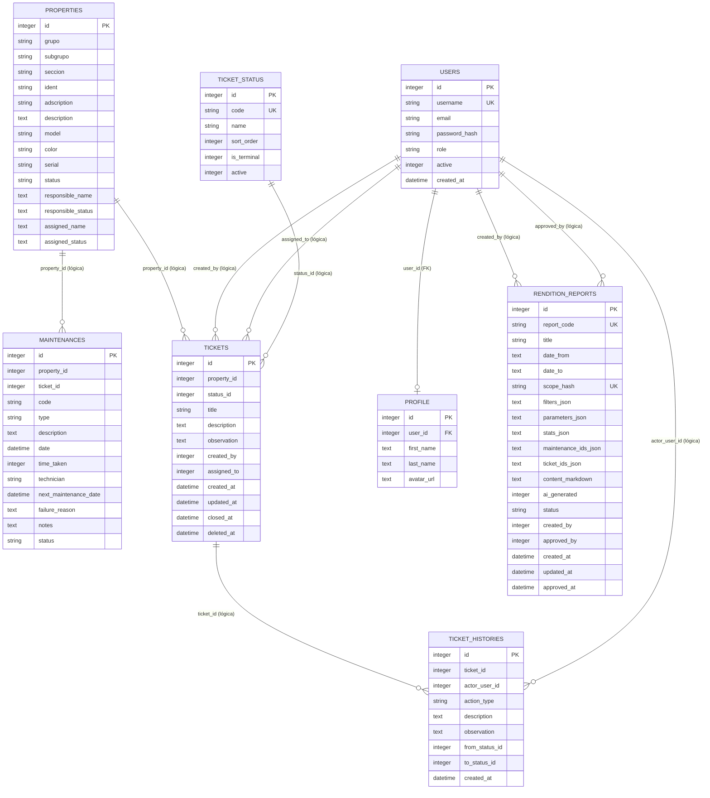

# Modelo de datos — SysTec GMB

> **Motor:** SQLite 3 (`storage/db.db`, configurable mediante `SYSTEC_DB`).
> **Estado:** esquema base en `conn.php`; evoluciones versionadas `001`–`011` en `migrations/`.
> **Fecha de análisis:** 2026-11-26.

---

## 1. Diagrama entidad-relación



**Realidad física:** `profile.user_id` es la única clave foránea declarada y apunta a `users(id)` con `ON DELETE CASCADE`. Las demás relaciones se validan en aplicación y no tienen `FOREIGN KEY` declarado. Los triggers de `properties` y `maintenances` validan catálogos y transiciones.

---

## 2. DDL efectivo de usuarios y perfiles

`conn.php` crea la tabla base `users`; la migración `009_seed_personal_users.sql` agrega `email`. La migración `010_create_profile.sql` crea `profile` con unicidad por usuario.

```sql
CREATE TABLE IF NOT EXISTS users (
    id            INTEGER PRIMARY KEY AUTOINCREMENT,
    username      TEXT NOT NULL UNIQUE,
    password_hash TEXT NOT NULL,
    role          TEXT NOT NULL DEFAULT 'consulta',
    active        INTEGER NOT NULL DEFAULT 1,
    created_at    DATETIME NOT NULL DEFAULT CURRENT_TIMESTAMP,
    email         TEXT
);

CREATE UNIQUE INDEX IF NOT EXISTS idx_users_email_unique
    ON users (email)
    WHERE email IS NOT NULL AND trim(email) <> '';

CREATE TABLE IF NOT EXISTS profile (
    id         INTEGER PRIMARY KEY AUTOINCREMENT,
    user_id    INTEGER NOT NULL UNIQUE REFERENCES users(id) ON DELETE CASCADE,
    first_name TEXT NOT NULL,
    last_name  TEXT NOT NULL,
    avatar_url TEXT
);
```

El DDL completo de tickets, historial, informes de rendición y tablas operativas se mantiene en `docs/DATABASE.md`.

---

## 3. Diccionario de datos

### 3.1 `users` — cuenta de acceso

| Columna | Tipo | Nulo | Regla |
|---|---|---|---|
| `id` | INTEGER | No | PK autoincremental |
| `username` | TEXT | No | `UNIQUE`; login; el alta web exige 3–64 caracteres alfanuméricos, punto, guion o guion bajo |
| `email` | TEXT | Sí | Único cuando no está vacío; las cuentas personales sembradas usan `username@cmsf.gob.ve` |
| `password_hash` | TEXT | No | `password_hash(PASSWORD_DEFAULT)`; nunca se almacena texto plano |
| `role` | TEXT | No | `admin`, `operador`, `tecnico`, `consulta`, `personal` |
| `active` | INTEGER | No | `0` impide el login |
| `created_at` | DATETIME | No | `CURRENT_TIMESTAMP` |

### 3.2 `profile` — perfil del usuario

| Columna | Tipo | Nulo | Regla |
|---|---|---|---|
| `id` | INTEGER | No | PK autoincremental |
| `user_id` | INTEGER | No | `UNIQUE`; FK a `users(id)` con borrado en cascada |
| `first_name` | TEXT | No | Nombre; el guardado web limita a 120 caracteres |
| `last_name` | TEXT | No | Apellidos; el guardado web limita a 120 caracteres |
| `avatar_url` | TEXT | Sí | URL `http`/`https`; vacío se persiste como `NULL` |

El seeder `bin/seed-profiles.php` actualiza `first_name` y `last_name` por `username`, conserva `avatar_url` y no crea usuarios. La gestión web se realiza desde el drawer de `/users.php`; el alta y la edición de usuario/perfil son transaccionales.

---

## 4. Volumen y calidad de datos — snapshot 2026-11-26

| Métrica | Valor |
|---|---:|
| Bienes | 627 |
| Mantenimientos | 324 |
| Usuarios | 29 |
| Perfiles | 29 |
| Tickets | 8 |
| Informes de rendición | 1 |
| Migraciones aplicadas | 11 (`001`–`011`) |

Los conteos son una foto operativa, no una invariante del esquema. Las migraciones `009`–`011` son la referencia canónica para las 23 cuentas personales sembradas y sus usernames; las altas manuales posteriores pueden variar el total.

---

## 5. Consultas que definen el negocio

| Consulta | Archivo | Propósito |
|---|---|---|
| `SELECT ... FROM users LEFT JOIN profile ON profile.user_id = users.id` | `users.php` | Listado de cuentas con perfil |
| `SELECT * FROM properties` | `dashboard.php` | Listado de bienes |
| `SELECT * FROM maintenances WHERE property_id = N ORDER BY date ASC` | `historials.php` | Historial por bien |
| `SELECT ... FROM tickets WHERE created_by = N AND deleted_at IS NULL` | `TicketRepository` | Tickets propios del personal |
| `INSERT ... ON CONFLICT(user_id) DO UPDATE` | `bin/seed-profiles.php` | Sincronización idempotente de perfiles |

---

## 6. Estrategia de migración

- `bin/migrate.php --backup=RUTA` exige un backup legible con `PRAGMA integrity_check = ok` y conteos coincidentes de `properties`, `maintenances` y `users`.
- Cada archivo se ejecuta en `BEGIN IMMEDIATE` y se registra en `schema_migrations`; un fallo revierte la transacción.
- `001`–`002`: normalización, triggers e índices.
- `003`–`005`: tickets, estados, historial, baja lógica e índice de tickets personales.
- `006`–`007`: asignaciones de bienes y vínculo mantenimiento–ticket.
- `008`: informes de rendición.
- `009`: email y cuentas personales canónicas.
- `010`: tabla y perfiles personales.
- `011`: corrección de usernames y emails derivados.

La reversión operativa sigue siendo restaurar un backup verificado; no existen migraciones `down`.

---

## 7. Datos sensibles y retención

| Dato | Sensibilidad | Tratamiento actual |
|---|---|---|
| Usuarios, hashes, emails y perfiles | Alta | `storage/db.db`; acceso administrativo; hashes con `password_hash()` |
| Avatares externos | Media | URL validada `http`/`https`; la CSP permite imágenes externas y `referrerpolicy=no-referrer` |
| Inventario, historial y tickets | Media/Alta | Sesión y roles; `storage/` denegado por router/htaccess |
| Backups | Alta | Snapshot SQLite; cifrado obligatorio solo cuando se configura `SYSTEC_BACKUP_KEY_FILE` |

Ver `docs/DATABASE.md`, `docs/SECURITY.md` y `docs/BACKUP.md` para el detalle operativo.
