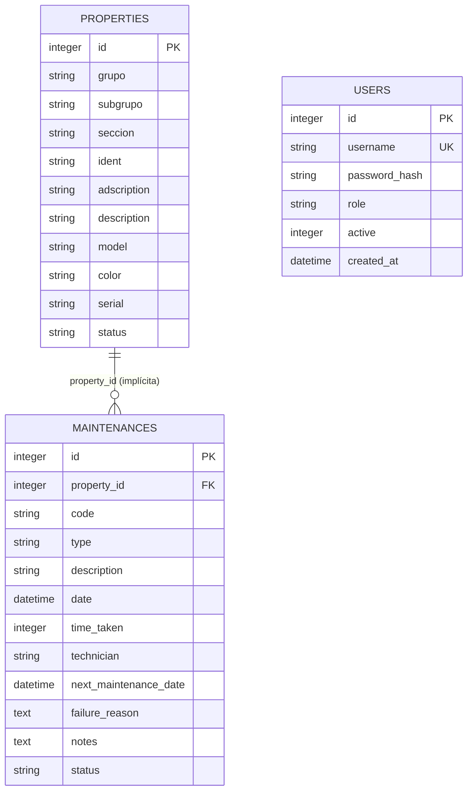

# Modelo de datos — SysTec GMB

> **Motor:** SQLite 3 (archivo `storage/db.db`).
> **Estado:** `conn.php` crea las tablas base; F2 agrega migraciones versionadas, triggers e índices.
> **Fecha de análisis:** 2026-11-09 (actualizado tras F2).

---

## 1. Diagrama entidad-relación



**Realidad física:** no existe `FOREIGN KEY`; triggers validan estados, transiciones y tipos. Existen índices secundarios en `ident`, `property_id` y `(status, next_maintenance_date)`. `users.username` es `UNIQUE`.

---

## 2. DDL efectivo

```sql
CREATE TABLE IF NOT EXISTS properties (
    id          INTEGER PRIMARY KEY AUTOINCREMENT,
    grupo       STRING,
    subgrupo    STRING,
    seccion     STRING,
    ident       STRING,
    adscription STRING,
    description STRING,
    model       STRING,
    color       STRING,
    serial      STRING,
    status      STRING
);

CREATE TABLE IF NOT EXISTS maintenances (
    id                    INTEGER PRIMARY KEY AUTOINCREMENT,
    property_id           INTEGER,
    code                  STRING,
    type                  STRING,
    description           STRING,
    date                  DATETIME,
    time_taken            INTEGER,
    technician            VARCHAR(255),
    next_maintenance_date DATETIME,
    failure_reason        TEXT,
    notes                 TEXT,
    status                STRING
);

CREATE TABLE IF NOT EXISTS users (
    id            INTEGER PRIMARY KEY AUTOINCREMENT,
    username      TEXT NOT NULL UNIQUE,
    password_hash TEXT NOT NULL,
    role          TEXT NOT NULL DEFAULT 'consulta',
    active        INTEGER NOT NULL DEFAULT 1,
    created_at    DATETIME NOT NULL DEFAULT CURRENT_TIMESTAMP
);
```

SQLite aplica afinidad dinámica: `STRING` y `VARCHAR(255)` se comportan como `TEXT`; `INTEGER` como entero; `DATETIME` como texto. Las fechas existentes se normalizaron a `YYYY-MM-DD HH:MM:SS`; las fechas nuevas de `next_maintenance_date` pueden seguir siendo `YYYY-MM-DD`.

Las migraciones `001_normalize_legacy_data.sql` y `002_add_indexes.sql` aplican la normalización y las restricciones actuales; `bin/migrate.php` registra su versión en `schema_migrations`.

---

## 3. Diccionario de datos

### 3.1 `properties` — bien

| Columna | Tipo | Nulo | Dominio observado | Regla |
|---|---|---|---|---|
| `id` | INTEGER | No | Autoincremental | PK |
| `grupo` | STRING | Sí | Numérico como texto | Parte del código |
| `subgrupo` | STRING | Sí | Numérico, rellenado a 4 | Parte del código |
| `seccion` | STRING | Sí | Numérico, rellenado a 3 al importar y 4 al mostrar | Parte del código |
| `ident` | STRING | Sí | Único en los datos actuales | Identidad de negocio para importar |
| `adscription` | STRING | Sí | **Siempre vacío** (617/617) | Sin uso actual |
| `description` | STRING | Sí | Texto libre | Se muestra con `e()` (F1) |
| `model` | STRING | Sí | Texto libre; puede venir `marca - modelo` | 295/617 vacíos |
| `color` | STRING | Sí | Texto libre | Se muestra con `e()` en historial |
| `serial` | STRING | Sí | Texto libre | 321/617 vacíos |
| `status` | STRING | Sí | `BUENO` 392, `MALO` 187, `REGULAR` 33, `MUY MALO` 5 | Trigger de catálogo; 2 `MUY BUENO` se mapearon a `BUENO` |

`adscription` sigue vacío en SQLite; el dashboard lo resuelve en vivo desde las unidades organizativas legacy.

### 3.2 `maintenances` — mantenimiento

| Columna | Tipo | Nulo | Dominio observado | Regla |
|---|---|---|---|---|
| `id` | INTEGER | No | Autoincremental | PK |
| `property_id` | INTEGER | Sí | 547/547 con bien existente | Relación lógica, sin FK |
| `code` | STRING | Sí | Copia del código del bien | Snapshot de texto |
| `type` | STRING | Sí | `correctivo` 477, `preventivo` 69, `evaluativo` 1 | Trigger de catálogo; `evaluativo` aprobado |
| `description` | STRING | Sí | Texto libre | Se muestra con `e()` (F1) |
| `date` | DATETIME | Sí | 1999–2026; ISO 8601 normalizado | Fecha del mantenimiento |
| `time_taken` | INTEGER | Sí | 15 nulos; valores históricos preservados | Horas totales al finalizar; importación nueva lo deja nulo |
| `technician` | VARCHAR | Sí | `ndominguez` 547 | Texto libre, sin FK |
| `next_maintenance_date` | DATETIME | Sí | 474 `NULL`; hasta 2024-12-11 | Base del vencimiento |
| `failure_reason` | TEXT | Sí | 65 vacíos | Razón del mantenimiento |
| `notes` | TEXT | Sí | 233 vacíos; contiene `desincorporación` | Insumo del reporte de dañados |
| `status` | STRING | Sí | `finalizado` 547 | Triggers SQLite validan catálogo y transiciones |

### 3.3 `users` — usuario de la aplicación

| Columna | Tipo | Nulo | Dominio observado | Regla |
|---|---|---|---|---|
| `id` | INTEGER | No | Autoincremental | PK |
| `username` | TEXT | No | `admin`, `operador`, `tecnico`, `consulta` | `UNIQUE`; login |
| `password_hash` | TEXT | No | `$2y$...` | `password_hash(PASSWORD_DEFAULT)` |
| `role` | TEXT | No | `admin`, `operador`, `tecnico`, `consulta` | Autorización en servidor |
| `active` | INTEGER | No | `1` / `0` | `0` impide login |
| `created_at` | DATETIME | No | `CURRENT_TIMESTAMP` | Auditoría mínima |

---

## 4. Volumen y calidad de datos (snapshot 2026-11-09)

| Métrica | Valor |
|---|---|
| Bienes | 617 |
| Mantenimientos | 547 |
| Bienes sin mantenimiento | 450 |
| Mantenimientos sin bien asociado | 0 |
| Mantenimientos vencidos (regla actual) | 0 (todos están `finalizado`) |
| Bienes `BUENO` | 392 |
| Bienes `MALO` | 187 |
| Bienes `REGULAR` | 33 |
| Bienes `MUY MALO` | 5 |
| Bienes `MUY BUENO` | 0 (normalizados a `BUENO`) |
| Mantenimientos `finalizado` | 547 |
| Mantenimientos sin `next_maintenance_date` | 474 |
| Mantenimientos sin `notes` | 233 |
| Mantenimientos sin `failure_reason` | 65 |
| Bienes sin `adscription` | 617 |
| Bienes sin `serial` | 321 |
| Bienes sin `model` | 295 |
| Usuarios | 4 (seed local) |

### 4.1 Inconsistencias detectadas

1. **Estados, tipos y técnico normalizados:** migración F2 aplicada; los triggers protegen catálogos y transiciones.
2. **Fechas normalizadas:** formatos válidos convertidos a ISO; no se encontraron fechas futuras.
3. **`time_taken` histórico no reconstruible:** se conservaron los valores y 15 nulos; no existen fechas de inicio/fin.
7. **`adscription` nunca poblado:** campo muerto en la práctica.
8. **`code` snapshot puede quedar obsoleto** si cambia el código del bien.
9. **`time_taken` legacy no reconstruible:** valores existentes preservados según ADR-016; las nuevas importaciones dejan el campo nulo.

---

## 5. Consultas que definen el negocio

| Consulta | Archivo | Propósito |
|---|---|---|
| `SELECT * FROM properties` | `dashboard.php` | Listado completo |
| `SELECT * FROM maintenances WHERE property_id = N` | `dashboard/table/index.php` | Conteo por bien |
| `SELECT * FROM properties INNER JOIN maintenances ... WHERE notes LIKE '%desincorporación%' AND status IN ('MALO','MUY MALO')` | `conn.php::indexWithMaintenances` | Reporte de dañados |
| `SELECT * FROM maintenances WHERE property_id = N ORDER BY date ASC` | `historials.php`, `historials/report.php` | Historial |
| `SELECT * FROM properties WHERE id = N` | `getFirstForId` | Detalle |
| `SELECT * FROM properties WHERE ident = N` | `createOrUpdate`, importación | Identidad de importación |
| `UPDATE properties SET status = ? WHERE id = ?` | `dashboard/actions/status.php` | Cambio de estado |
| `UPDATE maintenances SET status = ?, time_taken = ? WHERE id = ?` | `maintenances/actions/status.php` | Transición |
| `INSERT INTO maintenances (...)` | `register.php`, importación | Alta |
| `UPDATE maintenances SET ... WHERE id = ?` | `update.php` | Edición |

---

## 6. Estrategia de migración actual y propuesta

### Hoy (F2)

- `bin/migrate.php --backup=RUTA` valida integridad y conteos del backup antes de aplicar cambios.
- Las migraciones SQL se versionan en `migrations/` y se registran en `schema_migrations`.
- Cada migración corre en una transacción; si falla, se revierte.
- `001_normalize_legacy_data.sql` normaliza datos y crea triggers; `002_add_indexes.sql` agrega los índices mínimos.
- Backup previo a la normalización: `storage/backups/2026-11-09/db-before-f2-normalization.db`; restore verificado en copia aislada.

### Pendiente

1. Evaluar `FOREIGN KEY (property_id) REFERENCES properties(id)` mediante reconstrucción de tablas.
2. Desplegar la política acordada parcialmente en `docs/BACKUP.md`: destino separado y método/custodia de cifrado siguen pendientes de TI; el cron aún no está activo.
3. Agregar columnas de auditoría cuando se implemente `audit_events`.

---

## 7. Datos sensibles y retención

| Dato | Sensibilidad | Tratamiento actual | Retención sugerida |
|---|---|---|---|
| Inventario de bienes (descripción, serial, modelo, color) | Media | Requiere sesión; `storage/` denegado | Mientras el bien exista |
| Historial de mantenimientos y notas | Media | Requiere sesión; `storage/` denegado | Mientras el bien exista + plazo administrativo |
| Nombres de técnicos | Baja/Media (PII laboral) | Texto libre; acceso autenticado | Mientras el mantenimiento exista |
| Usuarios y hashes | Alta | `storage/db.db`; hashes con `password_hash` | Mientras la cuenta exista |
| `storage/db.db` y backups | Alta (agregado) | La base y copias existentes no están cifradas; la política futura exige cifrado, aún sin método/destino | Ver política parcialmente acordada en `docs/BACKUP.md` |

Ver `docs/SECURITY.md` para el análisis de riesgos, `docs/DATABASE.md` para el detalle del esquema y `docs/BACKUP.md` para la política de respaldo.
