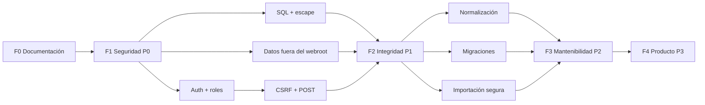

# Plan de documentación y ejecución — SysTec GMB

> **Estado:** v1.2 · **Actualizado:** 2026-11-09 · **Dueño:** Oficina de Informática / equipo de mantenimiento.
> **Naturaleza:** plan de trabajo derivado del análisis inverso. **F0 está ejecutada, F1 está en cierre de despliegue y F2 está en ejecución**; F3–F4 siguen priorizadas, sin compromiso de fecha. Cada tarea tiene criterio de aceptación verificable y trazabilidad a un hallazgo (`H-xx`/`D-xx`) y a `TODO.md`.
> **Fuentes:** código en `*.php`, migraciones y snapshot de datos de `storage/db.db`; los anexos F0/F1 son evidencia histórica, no describen por sí solos el estado actual.

---

## 1. Propósito y uso

Este documento responde tres preguntas:

1. **Qué se documentó y con qué evidencia** (fase F0, cerrada).
2. **Qué falta para que el sistema sea seguro y mantenible** (fases F1–F4).
3. **Cómo se verifica que una tarea terminó** (criterios de aceptación y gates).

Se usa así:

- **Al planificar:** toma una tarea de §7, verifica dependencias en §10 y riesgos en §11.
- **Al ejecutar:** copia la plantilla de §14, registra evidencia y actualiza `TODO.md`.
- **Al cerrar:** cumple el Definition of Done de §8 y actualiza `CHANGELOG.md`.
- **Al heredar:** lee §2, §3 y §15 para entender qué existe, qué no y por qué.

---

## 2. Resumen ejecutivo

SysTec GMB es un monolito PHP 7.4 + SQLite sin framework. F0 dejó la documentación baseline; F1 agregó controles de aplicación y dejó pendiente el cierre de despliegue (HTTPS/HSTS). F2 implementó importaciones transaccionales y limitadas, normalización aprobada, triggers, migraciones e índices. No hay suite automatizada ni política operativa de backups.

**Resultado de F0:** 14 documentos propios en `docs/`, 4 archivos en `grafo/`, 22 hallazgos técnicos (`H-01`…`H-22`), 10 hallazgos de datos (`D-01`…`D-10`) y una matriz de trazabilidad completa. F2 ya incluye importaciones transaccionales con límites, reporte deduplicado, normalización aprobada, triggers, migraciones e índices.

**Riesgo principal:** no exponer el sistema fuera de una red de confianza hasta configurar HTTPS/HSTS y cerrar el checklist de despliegue. Siguen pendientes auditoría, pruebas automatizadas y calendario/retención/cifrado de backups; los técnicos siguen siendo texto libre.

**Secuencia recomendada:** cerrar despliegue de seguridad (F1) → sanear datos y persistencia (F2) → separar capas y probar (F3) → producto (F4). No se recomienda reescribir: el costo de perder reglas implícitas es mayor que el de endurecer por fases (ADR-013).

---

## 3. Alcance

### 3.1 Dentro del alcance

- Documentar el sistema **tal como está** (as-built), incluyendo deuda y comportamientos incorrectos.
- Modelar la lógica de negocio y el modelo de datos en `grafo/`.
- Proponer un backlog priorizado con criterios de aceptación.
- Definir el proceso documental para que la documentación no se degrade.
- Identificar riesgos de seguridad, integridad y operación.

### 3.2 Fuera del alcance

- Definir reglas de negocio nuevas o normalizar datos legacy sin aprobación del dueño.
- Reescribir la aplicación o migrar de stack.
- Cambiar datos reales de `db.db` o de los CSV.
- Modificar `docs/templatesOthersApp/`: es referencia externa y se conserva intacta.
- Definir reglas de negocio nuevas sin aprobación del dueño (ver bloqueos `B-xx` en `TODO.md`).
- Generar PDFs firmados, app móvil o API pública (futuro P3).

---

## 4. Supuestos y restricciones

| Tipo | Supuesto / restricción | Impacto si cambia |
|---|---|---|
| Entorno | El entorno local es PHP 7.4.33; la versión real de producción no está verificada | El código es compatible con PHP 7.4; confirmar la versión mínima del despliegue |
| Datos | `db.db` es la fuente de verdad; los CSV son legacy | Cambia la estrategia de importación y backup |
| Operación | Uso interno en red de confianza | Si se expone a internet, F1 es obligatorio antes |
| Equipo | Equipo pequeño, sin Composer ni CI | Las tareas deben ser incrementales y de bajo tooling |
| Versionado | El directorio no es un repositorio git | No hay rollback por commit; el backup es la única red |
| Dueño | Las reglas de negocio las valida la Oficina de Informática | Sin dueño, los bloqueos `B-xx` quedan abiertos |
| Referencia | `docs/templatesOthersApp/` solo aporta estructura y nivel de detalle | No se copian reglas de otro dominio |

---

## 5. Principios rectores

1. **Evidencia antes que opinión.** Toda afirmación se contrasta con código o datos; lo no verificado se marca como supuesto.
2. **As-built, no aspiracional.** La documentación describe lo que existe; las propuestas van en `DECISIONS.md` y `TODO.md`.
3. **Un hallazgo, un ID, una tarea.** `H-xx`/`D-xx` se mantienen estables entre grafo, docs y backlog.
4. **Seguridad primero, sin big-bang.** F1 contiene el riesgo; F2–F3 mejoran sin detener la operación.
5. **Cambios pequeños y reversibles.** Cada tarea toca una capa, tiene backup y criterio de aceptación.
6. **Documentación viva.** Un cambio sin actualización de docs se considera incompleto.
7. **Honestidad sobre límites.** Lo que no se pudo verificar (p. ej. versión real de producción) se declara, no se inventa.

---

## 6. Arquitectura del plan

| Fase | Objetivo | Prioridad | Estado | Gate de salida |
|---|---|---|---|---|
| **F0** | Documentación baseline y grafo | — | ✅ 2026-11-09 | Documentos revisados y trazabilidad completa |
| **F1** | Contener riesgo de seguridad | P0 | 🧪 Código implementado; despliegue pendiente | HTTPS/HSTS y checklist P0 de `SECURITY.md` completo |
| **F2** | Integridad de datos y persistencia | P1 | 🧪 En ejecución | Datos normalizados, migraciones, importación segura y política operativa de backups |
| **F3** | Mantenibilidad y pruebas | P2 | 🔲 | Capas separadas, validación centralizada, CI local |
| **F4** | Producto y operación | P3 | 🔲 | Exportaciones, notificaciones e indicadores |

La secuencia no es rígida dentro de una fase, pero **F1 no se salta**. Un ítem de F2 puede adelantarse solo si no toca seguridad y tiene backup verificado.

---

## 7. Fases en detalle

### F0 — Documentación baseline ✅ (ejecutada 2026-11-09)

**Objetivo:** reconstruir el sistema y dejar una base documental confiable.

| ID | Entregable | Evidencia | Estado |
|---|---|---|---|
| F0-01 | Inventario folder por folder y archivo por archivo | `docs/anexos/inventario-tecnico.md` | ✅ |
| F0-02 | Grafo de lógica de negocio, modelo de datos y JSON | `grafo/logica-negocio.md`, `grafo/modelo-datos.md`, `grafo/grafo.json` | ✅ |
| F0-03 | Documentos de producto, arquitectura, dominio, datos, API, seguridad, convenciones y decisiones | `docs/*.md` | ✅ |
| F0-04 | Backlog priorizado, bloqueos y métricas | `docs/TODO.md` | ✅ |
| F0-05 | Matriz de trazabilidad hallazgo → código → documento → tarea | `docs/anexos/matriz-trazabilidad.md` | ✅ |
| F0-06 | Plan de ejecución y registro | este documento | ✅ |

**Criterio de salida (cumplido):**

- [x] Todo archivo de aplicación inventariado.
- [x] Todo hallazgo tiene ID, evidencia, impacto, documento y tarea.
- [x] Todo documento declara estado, fecha y fuentes.
- [x] Los diagramas Mermaid renderizan sin error.
- [x] No se modificó código, `db.db`, CSV ni backups.

**Limitaciones declaradas de F0:**

- No se verificó la versión de PHP de producción (solo el entorno local).
- No se ejecutó la aplicación en navegador; el análisis es estático + datos.
- No hay historial git, por lo que las decisiones son reconstruidas.

---

### F1 — Contención de seguridad (P0)

**Objetivo:** que el sistema pueda operar sin exponer datos ni permitir mutaciones anónimas.

| ID | Tarea | Hallazgo | Criterio de aceptación | Depende |
|---|---|---|---|---|
| F1-01 | Login con sesión PHP (`password_hash`/`password_verify`) | H-01 | Sin sesión, toda ruta redirige a login; cookie `HttpOnly`, `Secure`, `SameSite=Lax` | — |
| F1-02 | Roles `admin`/`operador`/`tecnico`/`consulta` | H-01 | Matriz de `SECURITY.md` §4.2 aplicada en servidor; `consulta` no muta | F1-01 |
| F1-03 | Parametrizar todo el SQL de `DB` | H-02 | Ningún método concatena valores; pruebas SQLi verdes | — |
| F1-04 | Helper `e()` y escape de todas las vistas | H-03 | `<script>alert(1)</script>` no ejecuta en ningún campo | — |
| F1-05 | Mover `db.db`, `bck/` y CSV fuera del webroot o denegarlos | H-12 | `/db.db`, `/bck/...`, `/*.csv` devuelven 403/404 | — |
| F1-06 | CSRF y acciones que mutan por POST | H-06 | Cambios de estado y formularios exigen token; GET no muta | F1-01 |
| F1-07 | Endurecer despliegue (HTTPS, headers, errores, logs) | H-01, H-12 | Checklist de `SECURITY.md` §7 completo; `display_errors=Off` | F1-05 |

**Criterio de salida:**

- [ ] El checklist P0 de `SECURITY.md` está 100 % marcado.
- [ ] Un usuario anónimo no puede leer ni escribir datos.
- [ ] Un rol `consulta` no puede ejecutar acciones de estado.
- [ ] Las pruebas de SQLi, XSS, CSRF y acceso directo pasan.
- [ ] Existe backup verificado previo a cualquier cambio de datos.

---

### F2 — Integridad de datos y persistencia (P1)

**Objetivo:** que los datos sean consistentes, las importaciones seguras y el esquema evolucione con rollback.

| ID | Tarea | Hallazgo | Criterio de aceptación | Depende |
|---|---|---|---|---|
| F2-01 | Normalizar estados de mantenimiento y bien | H-07, D-01, D-03 | Estados aprobados normalizados; triggers rechazan valores inválidos | Backup |
| F2-02 | Normalizar tipos y técnicos | H-07, D-02, D-04 | `evaluativo` en catálogo; `ndomiguez` corregido | Dueño |
| F2-03 | Normalizar fechas | D-05, D-06 | Fechas ISO 8601; fechas futuras revisadas | Backup |
| F2-04 | Corregir `time_taken` | H-05, D-08 | Horas totales; prueba > 24 h; históricos no reconstruibles preservados | — |
| F2-05 | Máquina de estados de mantenimiento | H-06 | Transiciones válidas en servidor + SQLite; estado/transición inválida rechazada | F2-01 |
| F2-06 | Importación segura | H-15, D-08 | POST + confirmación + transacción + reporte de válidas/omitidas/erróneas; máximo 5000 filas y 5 MB | F1-03 |
| F2-07 | Reporte de dañados sin duplicados | H-08 | `DISTINCT`/`EXISTS`; prueba con múltiples notas | — |
| F2-08 | Quitar fechas y nombres hardcodeados | H-10 | Fecha actual y técnico real en historial/membrete | — |
| F2-09 | Migraciones versionadas | H-13 | `migrations/` + `schema_migrations`; backup y rollback documentados | — |
| F2-10 | Índices mínimos | H-13 | `ident`, `property_id`, `(status, next_maintenance_date)` | F2-09 |
| F2-11 | Corregir `update.php` | H-04, H-20 | Usa `validations/update.php`; valida `id` y `status` | — |
| F2-12 | Corregir `batch.php` | H-09 | `$property_id` inicializado; sin avisos | — |
| F2-13 | Backup y restore probados | H-13 | Backup con fecha, `integrity_check`, restore documentado | — |
| F2-14 | Resolver compatibilidad PHP 8 | H-16 | `match` reemplazado por `switch` o versión de PHP elevada y documentada | — |
| F2-15 | Verificar orden de carga DataTables/jQuery | H-17 | Tablas inicializan sin error en todas las vistas | — |
| F2-16 | Definir y desplegar política operativa de backups | H-13 | Política registrada; destino, cifrado/custodia y cron verificados; primera restauración periódica aprobada | F2-13 |

**Criterio de salida:**

- [x] Los estados y tipos aprobados están normalizados y protegidos; el técnico legacy conocido se corrigió (el campo sigue siendo texto libre).
- [x] Cálculo nuevo de `time_taken` en horas totales verificado; los valores históricos se conservan porque no hay fechas de inicio/fin para verificarlos.
- [x] La importación informa filas inválidas; las válidas se confirman en transacción y un fallo no capturado revierte el archivo.
- [x] Migraciones probadas en base temporal y base nueva.
- [x] Backup restaurado en entorno de prueba con conteos verificados.
- [x] Frecuencia, ventana, retención 30/12/12, selección semanal/mensual, alcance, RPO/RTO y restore trimestral registrados.
- [ ] TI asignó destino separado, aprobó cifrado/custodia de claves e instaló y verificó el cron.

---

### F3 — Mantenibilidad y pruebas (P2)

**Objetivo:** reducir el costo de cambio y detectar regresiones.

| ID | Tarea | Hallazgo | Criterio de aceptación | Depende |
|---|---|---|---|---|
| F3-01 | Catálogos en BD | H-07 | Tablas/enums; UI alimentada desde BD | F2-01…F2-02 |
| F3-02 | Separar capa de datos (`src/Database.php` + repositorios) | H-11, H-13 | Páginas sin SQL; `DB` sin cierre interno | F1-03 |
| F3-03 | Validación centralizada | H-04 | Un validador por contexto (`create`/`update`/`transition`) | F2-11 |
| F3-04 | Auditoría de cambios | H-06 | Tabla `audit_events`; escritura en la misma transacción | F1-01 |
| F3-05 | Pruebas unitarias e integración | H-13 | Runner ejecutable; ≥ 60 % en reglas críticas | F3-02 |
| F3-06 | Logs sin PII y rotación | H-13 | Archivo fuera del webroot; niveles definidos | F1-07 |
| F3-07 | Limpiar código muerto y configuración | H-14, H-18, H-19, H-21 | Archivos sin uso eliminados o justificados; `.gitignore` corregido | — |
| F3-08 | Selector explícito de estado del bien | H-06 | Reemplaza botón cíclico; motivo y auditoría | F1-02, F3-04 |

**Criterio de salida:**

- [ ] `php -l` limpio en todos los archivos.
- [ ] Suite mínima verde en local (reglas de código, vencimiento, horas, importación).
- [ ] Ninguna página contiene SQL concatenado.
- [ ] Un cambio de estado queda auditado con actor, antes y después.

---

### F4 — Producto y operación (P3)

**Objetivo:** agregar valor sin comprometer la estabilidad.

| ID | Tarea | Hallazgo | Criterio de aceptación | Depende |
|---|---|---|---|---|
| F4-01 | Exportación CSV/PDF de reportes | — | Botón de exportación; PDF generado o impresión guiada | F2-07 |
| F4-02 | Notificaciones de vencimiento | — | Correo o panel con vencidos próximos | F2-03 |
| F4-03 | API JSON (si se integra) | — | Contrato documentado en `API.md`; auth por token | F1-01 |
| F4-04 | Dashboard de indicadores | — | Tendencias, cumplimiento y costos | F2-03 |
| F4-05 | Gestión de técnicos y usuarios | — | CRUD y asignación de roles | F1-02, F3-01 |
| F4-06 | Snapshot de reportes | — | `report_versions` con hash; reproducibilidad | F3-04 |

**Criterio de salida:**

- [ ] Cada funcionalidad nueva tiene ruta documentada, prueba y rollback.
- [ ] No se agregan dependencias sin vendorizar o documentar.
- [ ] Los reportes son reproducibles o se declara explícitamente que no lo son.

---

## 8. Definition of Done

### 8.1 DoD documental

Un documento se considera terminado cuando:

- [ ] Declara estado, fecha, dueño y fuentes.
- [ ] Distingue hechos verificados de supuestos y propuestas.
- [ ] Tiene enlaces relativos válidos.
- [ ] Los diagramas Mermaid renderizan.
- [ ] Los IDs `H-xx`/`D-xx` coinciden con la matriz de trazabilidad.
- [ ] No contradice `DOMAIN.md`, `DATABASE.md`, `API.md` ni `SECURITY.md`.
- [ ] Está enlazado desde `docs/README.md`.

### 8.2 DoD técnico

Una tarea de código se considera terminada cuando:

- [ ] Funciona en el caso feliz y en los casos límite documentados.
- [ ] El SQL está parametrizado y la salida escapada.
- [ ] Las acciones que mutan usan POST + CSRF.
- [ ] Tiene al menos una prueba manual documentada (o automática si existe runner).
- [ ] Se actualizaron `API.md`, `DATABASE.md`, `DOMAIN.md`, `TODO.md` y `CHANGELOG.md` según corresponda.
- [ ] Existe backup verificado si tocó datos.
- [ ] Se creó un ADR si cambió el rumbo.

### 8.3 Gate por fase

| Gate | Pregunta de control | Evidencia |
|---|---|---|
| G0 | ¿La documentación refleja el código y los datos? | F0 completo |
| G1 | ¿El sistema es seguro para la red de confianza? | Checklist P0 |
| G2 | ¿Los datos son consistentes y restaurables? | Migraciones + restore |
| G3 | ¿El cambio es testeable y auditable? | Suite + auditoría |
| G4 | ¿La funcionalidad nueva es operable? | Manual + rollback |

---

## 9. Roles y responsabilidades

| Rol | Responsabilidad | Decide |
|---|---|---|
| Dueño del sistema (Oficina de Informática) | Prioridad, reglas de negocio, aceptación | Alcance, `B-xx`, normalización |
| Líder técnico / staff engineer | Arquitectura, revisión, gates | ADR, secuencia, calidad |
| Desarrollador | Implementación y pruebas | Detalle de implementación |
| Operador de inventario | Validación funcional de datos | Catálogos y estados reales |
| Técnico de mantenimiento | Validación del ciclo operativo | Flujo de mantenimiento |
| Auditor / seguridad | Revisión de controles | Aprobación P0 |
| TI / infraestructura | Despliegue, backup, red | Exposición y hosting |

**Regla:** ninguna tarea P0 se cierra sin revisión de seguridad; ninguna normalización de datos se ejecuta sin aprobación del dueño y backup.

---

## 10. Dependencias y ruta crítica



**Ruta crítica:** F0 → F1-01/F1-02/F1-03/F1-05 → F1-06 → F2-09/F2-01 → F2-06 → F3-02/F3-05 → F4.

**Dependencias externas:**

- `B-01`, `B-02`, `B-03`, `B-04`, `B-06` y `B-10` resueltos con aprobación del dueño; `B-05`, `B-07`, `B-08` y `B-09` siguen pendientes.
- Backup verificado antes de cualquier migración de datos.
- Versión real de PHP de producción para cerrar H-16.
- Acceso a infraestructura para mover `db.db` y configurar headers/HTTPS.

---

## 11. Riesgos y mitigaciones

| ID | Riesgo | Prob. | Impacto | Mitigación | Dueño |
|---|---|---|---|---|---|
| R-01 | Exposición de datos durante F1 | Alta | Crítico | No exponer fuera de la red; aplicar F1-05 primero | TI |
| R-02 | Pérdida de datos al normalizar | Media | Alto | Backup + `integrity_check` + restore probado + transacción | Dev |
| R-03 | Reglas implícitas no documentadas | Media | Alto | Contrastar con operadores; pruebas de caso real | Dueño |
| R-04 | La versión real de PHP de producción difiere del entorno local | Media | Medio | `match` eliminado; confirmar la versión mínima del despliegue | Dev |
| R-05 | Refactor F3 rompe rutas | Media | Medio | Cambios incrementales, pruebas de humo, mantener rutas | Líder técnico |
| R-06 | Documentación se desactualiza | Alta | Medio | DoD documental + revisión por release | Líder técnico |
| R-07 | Importación accidental durante pruebas | Media | Alto | Mover a POST + confirmación antes de probar | Dev |
| R-08 | Falta de dueño para decisiones | Media | Alto | Escalar `B-xx`; no normalizar sin aprobación | Oficina |
| R-09 | Backup no restaurable | Media | Crítico | Probar restore en entorno aislado (F2-13) | TI |
| R-10 | Alcance creep en F4 | Alta | Medio | Priorizar por valor operativo; gate G4 | Dueño |

**Riesgo aceptado explícitamente:** mientras F1 no esté completo, el sistema solo puede operar en red de confianza y sin datos sensibles nuevos.

---

## 12. Gestión del cambio documental

1. **Antes del cambio:** identifica el documento afectado y el hallazgo/tarea.
2. **Durante:** mantén los IDs estables; no renombres `H-xx`/`D-xx`.
3. **Al cerrar:** actualiza `TODO.md`, `CHANGELOG.md` y, si aplica, `API.md`/`DATABASE.md`/`DOMAIN.md`.
4. **Si cambia una decisión:** crea un ADR nuevo en `DECISIONS.md`; no edites el anterior.
5. **Si cambia el esquema:** actualiza `DATABASE.md` y `grafo/modelo-datos.md` en el mismo cambio.
6. **Si cambia una ruta:** actualiza `API.md` y `grafo/grafo.json` si afecta una capacidad.
7. **Revisión:** cada release revisa enlaces, Mermaid, conteos y consistencia de IDs.

---

## 13. Métricas y puntos de control

| Métrica | Línea base 2026-11-09 | Estado actual | Objetivo | Fase |
|---|---|---|---|---|
| Rutas sin autenticación | 100 % | 0 % en código | 0 % | F1 |
| Métodos de `DB` con SQL concatenado | 5 | 0 | 0 | F1 |
| Vistas con salida sin escape | ≥ 7 | 0 | 0 | F1 |
| Datos sensibles bajo webroot | 4 rutas | 0 en router/.htaccess | 0 | F1 |
| Valores legacy fuera del catálogo aprobado / grafía técnica conocida | 2 estados + 1 tipo + 153 grafías | 0 casos conocidos; técnicos siguen como texto libre | 0 casos conocidos y decidir catálogo técnico | F2/F3 |
| Fechas inválidas/futuras | 1 inválida; 0 futuras | 0 inválidas/futuras | 0 | F2 |
| Duraciones históricas no verificables | 15 nulos + valores legacy | Se conservaron; no se recalculan sin fuente | Sin valores inventados | F2 |
| Importaciones sin reporte | 2 | 0 | 0 | F2 |
| Migraciones registradas | 0 | 2 | Cada cambio versionado | F2 |
| Cobertura de pruebas | 0 % | Pruebas aisladas/manuales | ≥ 60 % crítico | F3 |
| Backups con restore probado | 0 | 1 (restore aislado) | 1 por trimestre | F2 |
| Documentos con enlaces rotos | 0 | Pendiente de revisión integral | 0 | Todas |

**Puntos de control:**

- **Semanal (F1):** revisar checklist P0 y bloqueos.
- **Por release:** verificar DoD, enlaces, Mermaid y métricas.
- **Trimestral:** probar restore y revisar retención de backups.
- **Al cambiar de fase:** actualizar `TODO.md` y este plan.

---

## 14. Plantillas operativas

### 14.1 Ficha de tarea

```markdown
### [ID] Título
- **Hallazgo:** H-xx / D-xx
- **Objetivo:**
- **Alcance:** (archivos/rutas)
- **Fuera de alcance:**
- **Criterio de aceptación:** (verificable)
- **Prueba:** (comando o pasos)
- **Riesgo / rollback:**
- **Depende de:**
- **Estado:** 🔲 / 🧪 / ✅ / ⛔
```

### 14.2 Registro de evidencia

```markdown
| Fecha | Tarea | Evidencia | Verificado por | Resultado |
|---|---|---|---|---|
| YYYY-MM-DD | F1-03 | `curl` con payload SQLi | Seguridad | ✅ |
```

### 14.3 ADR

Usa la estructura de `DECISIONS.md`: contexto, alternativas, decisión, consecuencias, estado.

### 14.4 Checklist de revisión documental

- [ ] Enlaces relativos válidos.
- [ ] Mermaid renderiza.
- [ ] IDs consistentes con la matriz.
- [ ] Cifras actualizadas o marcadas como snapshot.
- [ ] Estado y fecha actualizados.
- [ ] Sin contradicciones entre documentos.

---

## 15. Registro de ejecución

| Fecha | Fase | Entregable | Evidencia | Estado |
|---|---|---|---|---|
| 2026-11-09 | F0 | Inventario técnico | `docs/anexos/inventario-tecnico.md` | ✅ |
| 2026-11-09 | F0 | Grafo de negocio y datos | `grafo/` | ✅ |
| 2026-11-09 | F0 | Documentos base | `docs/*.md` | ✅ |
| 2026-11-09 | F0 | Backlog y bloqueos | `docs/TODO.md` | ✅ |
| 2026-11-09 | F0 | Matriz de trazabilidad | `docs/anexos/matriz-trazabilidad.md` | ✅ |
| 2026-11-09 | F0 | Plan de ejecución | este documento | ✅ |
| 2026-11-09 | F1 | Controles de aplicación implementados; HTTPS/HSTS pendiente del despliegue | `docs/CHANGELOG.md`, `docs/SECURITY.md` | 🧪 |
| 2026-11-09 | F2 | F2-01…F2-05 normalización, catálogo y máquina de estados | `migrations/001_normalize_legacy_data.sql`; pruebas aisladas | ✅ |
| 2026-11-09 | F2 | F2-06 importación transaccional con límites | `include/csv_import.php`, `imports.php`, `updates.php` | ✅ |
| 2026-11-09 | F2 | F2-07 reporte de dañados sin duplicados | `conn.php`; prueba aislada con múltiples notas | ✅ |
| 2026-11-09 | F2 | F2-09/F2-10 migraciones e índices | `bin/migrate.php`, `migrations/`, pruebas en base temporal | ✅ |
| 2026-11-09 | F2 | F2-13 backup y restore de trabajo | `storage/backups/2026-11-09/db-before-f2-normalization.db`; restore 617/547/4 e integridad OK | ✅ |
| 2026-11-09 | F2 | F2-16 política inicial de backups | `docs/BACKUP.md`; valores definidos, destino/cifrado/cron pendientes de TI | 🧪 |
| — | F2 | Verificación histórica de `time_taken` | No hay fuente fiable de inicio/fin; los valores se conservan sin recalcular | ⚠️ |
| — | F3 | Mantenibilidad P2 | Pendiente | 🔲 |
| — | F4 | Producto P3 | Pendiente | 🔲 |

**Decisiones tomadas en F0:**

- Documentar as-built, no aspiracional.
- No tocar código ni datos.
- Conservar `docs/templatesOthersApp/` como referencia.
- Usar Mermaid y un `grafo.json` legible por máquina.
- Mantener IDs estables para trazabilidad.

**Pendientes inmediatos:**

1. Configurar y verificar HTTPS/HSTS en el servidor real antes de exponer el sistema.
2. Confirmar con TI el destino fuera del host y el método/custodia de cifrado; luego instalar y probar cron según `docs/BACKUP.md`.
3. Mantener sin recalcular `time_taken` histórico mientras no exista una fuente fiable de inicio/fin.
4. Resolver `B-05`, `B-07`, `B-08` y `B-09` antes de cambios de producto o exposición externa.

---

## 16. Referencias

- `docs/README.md` — índice y proceso documental.
- `docs/TODO.md` — backlog priorizado y bloqueos.
- `docs/SECURITY.md` — hallazgos y checklist P0.
- `docs/DECISIONS.md` — ADR-001…ADR-017.
- `docs/anexos/matriz-trazabilidad.md` — hallazgo → código → doc → tarea.
- `docs/anexos/inventario-tecnico.md` — evidencia archivo por archivo.
- `grafo/logica-negocio.md` y `grafo/modelo-datos.md` — lógica y datos.
- `docs/templatesOthersApp/` — referencia externa de estructura, no de dominio.

---

Ver también: `docs/README.md`, `docs/TODO.md`, `docs/SECURITY.md`, `docs/anexos/matriz-trazabilidad.md`.
